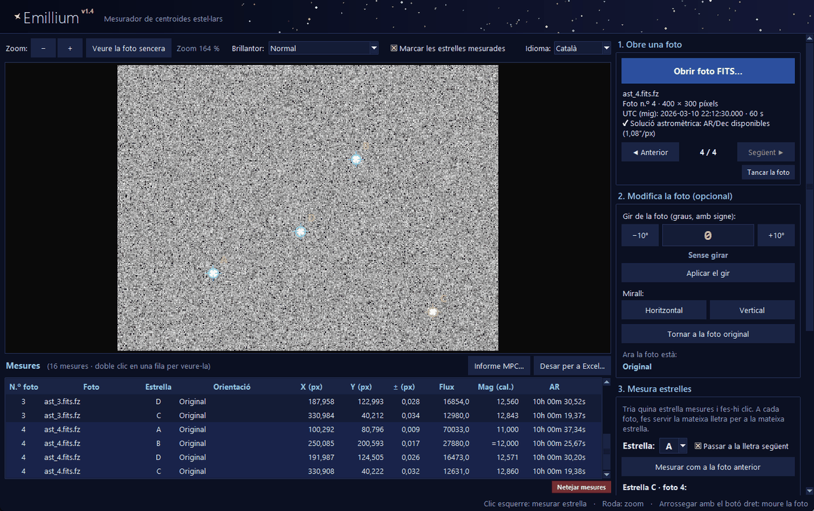
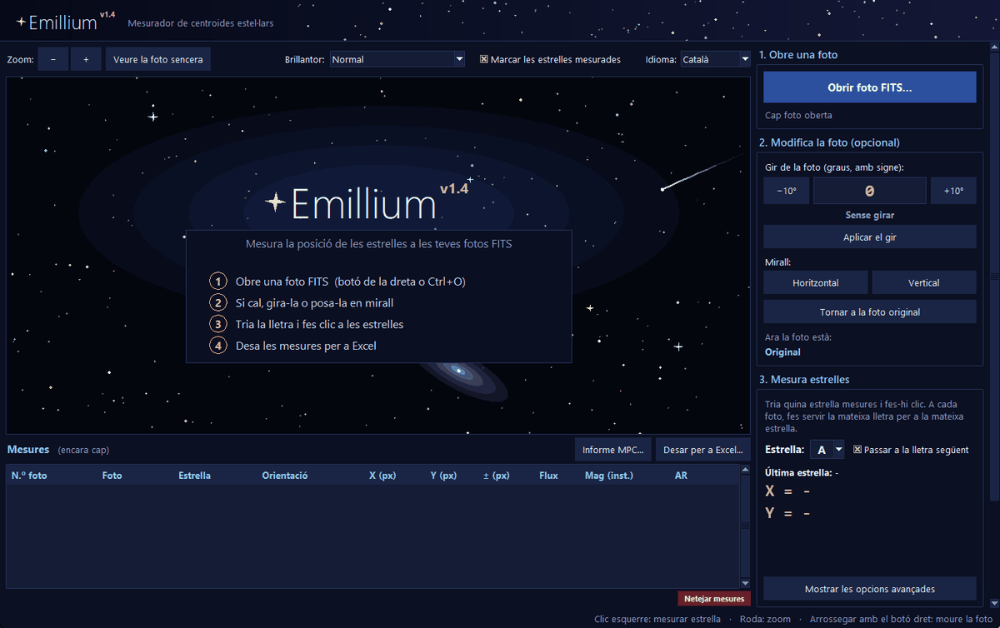
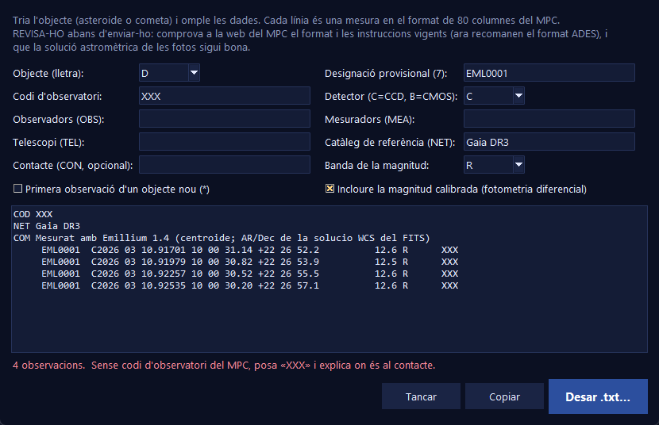

<a name="catala"></a>

<p align="center">
  
</p>

<h1 align="center">Emillium Expanded</h1>

<p align="center">
  <b>Mesurador de centroides estel·lars per a fotos astronòmiques FITS</b><br>
  <sub>Expanded · v1.4</sub>
</p>

<p align="center">
  
  
  
  
  
  
</p>

<p align="center">
  <b>Català</b> · <a href="#castellano">Castellano</a>
</p>

<p align="center">
  
</p>

**Emillium Expanded** és l'edició ampliada d'Emillium: mesura la posició de les estrelles en fotos
**FITS** amb **precisió de centèsimes de píxel** i hi afegeix tot el que cal per fer astrometria i
fotometria. Obres una foto (o una sèrie), fas clic a les estrelles i ho tens tot en un Excel, amb la seva
incertesa, magnitud i coordenades celestes.

Està pensat per a **astrònoms aficionats**:
moviments propis, estrelles dobles, satèl·lits de Júpiter, seguiment d'asteroides i cometes,
estrelles variables...

> **Lleuger** — un sol `.exe` de ~25 MB, sense instal·lar res.<br>
> **Privat** — funciona sense internet i no envia cap dada.<br>
> **Obert i explicat** — tot (lector FITS, centroide, coordenades, Excel...) està programat a mà a
> [`codigo/Emillium.py`](codigo/Emillium.py) i comentat pas a pas.

---

## Índex

- [Funcions](#funcions)
- [Captures](#captures)
- [Instal·lació](#installació)
- [Guia ràpida](#guia-ràpida)
- [Precisió i validació](#precisió-i-validació)
- [Limitacions](#limitacions)
- [Com es calcula](#com-es-calcula)
- [Estructura del projecte](#estructura-del-projecte)
- [Autors i llicència](#autors-i-llicència)

---

## Funcions

| | |
|---|---|
| **Centroide subpíxel** | Centre de massa iteratiu amb llindar sobre el soroll. Agafa l'estrella **més propera al clic** i, si en té una de brillant enganxada, li treu la llum. |
| **Incertesa** | ± en X, Y i en el flux de cada mesura (soroll del cel i, si el FITS porta `GAIN`, de la pròpia estrella). |
| **Coordenades celestes** | **AR i Dec** de cada estrella si la foto té solució astromètrica (per exemple d'[Astrometry.net](https://nova.astrometry.net)): projecció TAN, amb o sense distorsió **SIP**. |
| **Temps** | Hora UTC del **mig de l'exposició** i **dia julià (JD)**, a partir de `DATE-OBS` (+ `TIME-OBS`) i `EXPTIME`. |
| **Fotometria** | Flux d'obertura i **magnitud instrumental**; amb una **estrella de comparació** de magnitud coneguda, **magnitud real** de totes les altres (fotometria diferencial). |
| **Sèries de fotos** | Obre-ne moltes de cop, passa d'una a l'altra amb ◀ ▶ mantenint gir i zoom, i **mesura automàticament les mateixes estrelles que a la foto anterior**. |
| **FITS comprimits** | Obre directament fitxers **`.fz`** (RICE_1, GZIP_1, GZIP_2, també en coma flotant quantitzada), sense programes externs. |
| **Informe per al MPC** | Assistent que prepara les observacions d'un asteroide o cometa en el **format de 80 columnes del Minor Planet Center**, amb vista prèvia. |
| **Gir i mirall** | Angle amb signe, botons −10° / +10°, mirall horitzontal i vertical. Les estrelles ja mesurades segueixen marcades. |
| **Excel** | `.xlsx` real (no depèn de l'idioma d'Excel): una fila per foto i columnes per estrella, més un full amb totes les mesures. També CSV. |
| **Comoditat** | Català per defecte i castellà; recorda l'idioma, les opcions i l'última carpeta. |

## Captures

<table>
  <tr>
    <td width="58%"></td>
    <td></td>
  </tr>
  <tr>
    <td align="center"><sub>Pantalla d'inici</sub></td>
    <td align="center"><sub>Assistent de l'informe per al MPC</sub></td>
  </tr>
</table>

---

## Instal·lació

### Opció 1 · Executable per a Windows (recomanat)

1. A l'apartat [**Releases**](../../releases), descarrega l'executable d'**Emillium Expanded**.
2. Fes-hi doble clic. No cal instal·lar res.

> [!NOTE]
> Com que el programa no està signat digitalment, la primera vegada Windows pot mostrar
> «Windows ha protegit l'equip». Prem **Més informació → Executa igualment**.


### Opció 2 · Des del codi

Necessita **Python 3.9 o superior** (provat amb Python 3.14), amb `tkinter` (ja ve inclòs a Windows)
i `numpy`:

```bash
pip install -r codigo/requirements.txt
python codigo/Emillium.py
```

Està provat a Windows. A Linux i macOS hauria de funcionar des del codi, però encara no s'ha provat.

---

## Guia ràpida

1. **Obrir foto FITS…** (`Ctrl+O`). Pots triar-ne diverses alhora per treballar amb una sèrie.
2. *(Opcional)* Gira-la o posa-la en mirall.
3. Tria la **lletra** de l'estrella (A, B, C...) i fes-hi **clic**. Fes servir la mateixa lletra per a la
   mateixa estrella a totes les fotos.
4. Passa a la foto següent (▶) i prem **Mesurar com a la foto anterior**.
5. *(Opcional)* A **Fotometria diferencial**, tria l'estrella de comparació i escriu la seva magnitud.
6. **Desar per a Excel…** (`Ctrl+S`) o, per a un asteroide, **Informe MPC…**

<details>
<summary><b>Ratolí i dreceres de teclat</b></summary>

| Acció | Ratolí / tecla |
|---|---|
| Mesurar una estrella | Clic esquerre |
| Zoom | Roda del ratolí (a sobre del panell dret, el desplaça) |
| Moure la foto | Arrossegar amb el botó dret |
| Foto anterior / següent | `RePàg` / `AvPàg` |
| Esborrar les mesures seleccionades | `Supr` |
| Esborrar l'última mesura | `Ctrl+Z` |
| Obrir / desar | `Ctrl+O` / `Ctrl+S` |

</details>

<details>
<summary><b>Opcions avançades</b></summary>

- **Distància màx. al clic (px)**: fins on es busca l'estrella.
- **Radi per al centre (px)**: unes 2–3 vegades la FWHM de les estrelles.
- **Llindar sobre el soroll (σ)**: quins píxels compten per al centre. **Recomanat: 3.**
  Més baix, el soroll desvia el centre de les estrelles febles; molt alt (5 o més), en estrelles
  febles gairebé només compta el píxel central.

En canviar una opció, la mesura seleccionada (o l'última) es torna a calcular sola.

</details>

**Coordenades en píxels:** X cap a la dreta i Y cap amunt; el centre del píxel de baix a l'esquerra és
(0, 0). Es donen sobre la foto **tal com es veu** (després del gir i el mirall). Les AR/Dec sempre es
calculen sobre la foto original, així que no depenen del gir.

---

## Precisió i validació

Tot s'ha comprovat amb estrelles simulades en posicions conegudes i comparant amb
[astropy](https://www.astropy.org), la biblioteca de referència en astronomia:

| Què | Resultat |
|---|---|
| Centre d'estrelles brillants / febles | error de ~0,003–0,01 px / ~0,05 px |
| Incertesa ± predita | coincideix amb la dispersió real (simulació de Monte Carlo) amb un ~10–15 % |
| AR/Dec (TAN, CDELT+CROTA i SIP) | diferència màxima de **0,004″** amb astropy en 3.000 punts |
| Dia julià | diferència màxima de **0,5 ms** amb astropy en 500 dates |
| Fitxers `.fz` | resultat **idèntic** a astropy en 20 combinacions de compressió, tipus de dades i quantització |
| Fotometria diferencial | magnitud real d'una estrella simulada recuperada amb un error de 0,02 mag |
| Informe MPC | línies de 80 columnes; posicions a 0,02–0,11″ de les reals |

Per repetir les proves bàsiques (només necessita `numpy`):

```bash
python proves/prova_precisio.py
```

---

## Limitacions

**Fotos i coordenades**

- **No resol l'astrometria**: per tenir AR/Dec, la foto ha de venir ja resolta (Astrometry.net, ASTAP, Siril...).
- Les AR/Dec només surten amb solucions de projecció **TAN** (amb o sense SIP). Amb altres projeccions
  (TPV, ZPN...) la foto s'obre i es mesura en píxels, però sense coordenades celestes.
- Considera que `DATE-OBS` és l'**inici** de l'exposició (i hi suma `EXPTIME`/2). Si la teva càmera hi
  desa el mig de l'exposició, l'hora quedarà desplaçada mitja exposició.
- Llegeix només la **primera imatge** del fitxer FITS; si és una imatge en color (diversos plans), els
  fa la mitjana.
- No llegeix els formats comprimits poc habituals **HCOMPRESS_1** i **PLIO_1** (avisa; cal fer servir `funpack`).
- No calibra (biaix, foscos, flats) ni apila fotos.

**Mesures i resultats**

- Les incerteses ± són **estadístiques** (soroll): no inclouen errors sistemàtics ni l'error de la
  solució astromètrica de la foto.
- La fotometria diferencial fa servir **una** estrella de comparació, sense correcció de color ni d'extinció.
- L'informe del MPC és en el format clàssic de 80 columnes, que el MPC encara accepta, però des de 2018
  el format recomanat és **ADES**, i Emillium no el genera.

**Sistema**

- Només s'ha provat a **Windows**.

> [!IMPORTANT]
> Abans d'enviar cap informe al Minor Planet Center, revisa'l i consulta les instruccions vigents
> a la [web del MPC](https://minorplanetcenter.net). Comprova també que la solució astromètrica de
> les fotos sigui bona.

---

## Com es calcula

### El centre de cada estrella

#### La idea

En una foto, una estrella **no és un punt**: és una petita taca de llum que ocupa uns quants píxels,
molt brillant al mig i cada cop més fosca cap als costats. El **centre** de l'estrella és el **punt
d'equilibri** d'aquesta llum: si la taca fos una placa i cada píxel pesés tant com brilla, és el punt
on la podries aguantar amb un dit sense que caigués cap a cap costat. En física se'n diu **centre de
massa**.

Com que es fa una mitjana amb la llum de tots els píxels de la taca, el resultat pot caure **entre
dos píxels**. Per això Emillium dona posicions com `X = 229,415 px` i no només números enters.

#### Un exemple amb números

Imagina una fila de tres píxels d'una estrella, ja sense la llum del cel:

| Posició del píxel | 0 | 1 | 2 |
|---|:---:|:---:|:---:|
| Llum | 10 | 30 | 20 |

El píxel més brillant és el 1, però el 2 té més llum que el 0, així que el centre ha d'estar una mica
a la dreta del 1. El centre de massa ho calcula així:

> centre = (0 × 10 + 1 × 30 + 2 × 20) / (10 + 30 + 20) = 70 / 60 = **1,167**

Emillium fa exactament això, però en dues dimensions (X i Y) i amb tots els píxels de l'estrella.

#### Pas a pas

**1. Trobar l'estrella que vols.** Al voltant del clic, Emillium busca els **pics**: píxels més
brillants que els seus 8 veïns i que destaquen clarament sobre el soroll del cel. Si n'hi ha diversos,
tria **el més proper al clic**, no el més brillant. Així, si fas clic en una estrella feble que té una
de brillant al costat, la brillant no et «roba» el clic.

**2. Mesurar el cel.** El cel d'una foto mai és negre del tot: hi ha llum de la ciutat, de la Lluna, de
l'atmosfera i de la pròpia càmera. A més, cada píxel té una mica de **soroll** (petites variacions
a l'atzar). Emillium mira un **anell** de píxels al voltant de l'estrella, on ja no hi ha llum de
l'estrella, i calcula:
- el **fons**: quanta llum té el cel allà (la mediana, el valor del mig);
- el **soroll (σ)**: quant varia d'un píxel a un altre.

Abans, treu de l'anell els píxels estranys (per exemple, una altra estrella que hi caigui a sobre),
perquè no enganyin el càlcul.

**3. Comprovar que és una estrella.** Si el píxel més brillant no supera el fons en més de **llindar ×
σ** (per defecte, 3 vegades el soroll), allò no és una estrella sinó soroll, i Emillium t'avisa
en lloc de donar una posició inventada.

**4. Treure la llum de les veïnes.** Si hi ha una estrella brillant molt a prop, la seva llum es
barreja amb la de la teva i estiraria el centre cap a ella. Emillium aprofita que les estrelles són
**simètriques**: la llum de la veïna en un punt és igual que la del punt oposat respecte al seu centre.
Així pot calcular quanta llum de la veïna hi ha sobre la teva estrella i restar-la. També fa més petit
el cercle de mesura, perquè no arribi a tocar la veïna.

**5. Quedar-se només amb la llum de l'estrella.** A cada píxel se li resta el fons del cel i, a més,
el **llindar × σ**. Els píxels que queden per sota de zero no compten. Per què? Perquè a les vores de
l'estrella la llum és tan feble que es confon amb el soroll, i aquest soroll, que és a l'atzar, mouria
el centre cap a un costat o cap a l'altre. Fent servir només els píxels on l'estrella destaca de
veritat, el centre de les estrelles febles passa de tenir un error d'unes 0,4 px a unes 0,05–0,08 px.

**6. Calcular el centre i afinar-lo.** Amb els píxels que queden dins d'un **cercle** al voltant de
l'estrella (el *Radi per al centre*), es calcula el centre de massa com a l'exemple. Com que el cercle
estava centrat en el píxel més brillant i no en el centre de veritat, es torna a col·locar el cercle
sobre el centre nou i es calcula un altre cop. Es repeteix fins que el centre es mou **menys de
0,0001 píxels**, que normalment és en molt pocs passos.

**7. Calcular quant es pot equivocar (±).** Com que cada píxel té una mica de soroll, el centre que
surt també en té. Emillium calcula quant: mira el soroll de cada píxel que ha comptat i quant mouria
el centre (els píxels allunyats del centre el mouen més, com un pes a la punta d'una balança). Si el
FITS porta la paraula `GAIN`, també hi suma el soroll de la pròpia llum de l'estrella. Així cada mesura
surt amb el seu **±** en X, en Y i en el flux. Una estrella brillant pot tenir un ± de mil·lèsimes de
píxel; una de feble, de centèsimes o fins i tot dècimes.

**8. Comprovacions i dades extra.** Si el centre cau a menys de 1,5 px d'una estrella que ja havies
mesurat amb una altra lletra a la mateixa foto, Emillium t'avisa i no la desa (segurament has fet clic
dues vegades a la mateixa estrella). A més, et dona:
- el **flux**: tota la llum de l'estrella sumada, sense el cel (d'aquí surt la magnitud);
- la **mida (FWHM)**: l'amplada de l'estrella a la meitat de la seva brillantor màxima;
- quantes vegades el **pic** de l'estrella supera el soroll del cel.

Els resultats de les proves de precisió són a [Precisió i validació](#precisió-i-validació).

<details>
<summary><b>Les fórmules</b></summary>

Per a cada píxel *i* del cercle, amb posició (x<sub>i</sub>, y<sub>i</sub>) i brillantor B<sub>i</sub>:

> w<sub>i</sub> = B<sub>i</sub> − fons − llindar · σ  (si surt negatiu, w<sub>i</sub> = 0)
>
> X = Σ x<sub>i</sub> · w<sub>i</sub> / Σ w<sub>i</sub>  Y = Σ y<sub>i</sub> · w<sub>i</sub> / Σ w<sub>i</sub>

- **Fons i σ**: mediana i desviació típica dels píxels d'un anell que va de *r* + 3 a *r* + 9 píxels del
  centre (*r* = radi per al centre), traient els valors a més de 3σ de la mediana fins que no en
  queda cap.
- **Veïna brillant** (com a mínim la meitat de brillant que la teva i a menys de *r* + 8 px): amb
  centre (x<sub>v</sub>, y<sub>v</sub>), es resta la seva llum reflectida, B(2x<sub>v</sub> − x,
  2y<sub>v</sub> − y) − fons. El radi es redueix a 0,55 vegades la distància a la veïna més propera
  (mínim 1,5 px).
- **Incertesa del centre**: σ<sub>X</sub>² = Σ (x<sub>i</sub> − X)² · σ<sub>i</sub>² / (Σ w<sub>i</sub>)²
  (igual per a Y), amb σ<sub>i</sub>² = σ² (+ llum del píxel / `GAIN`).
- **Incertesa del flux**: σ<sub>F</sub>² = N · σ² · (1 + N / N<sub>anell</sub>) (+ F / `GAIN`), on N és el
  nombre de píxels del cercle i N<sub>anell</sub> el de l'anell.
- **FWHM** = 2,3548 · √(Σ w<sub>i</sub> · d<sub>i</sub>² / (2 Σ w<sub>i</sub>)), on d<sub>i</sub> és la
  distància del píxel al centre.

</details>

### La resta de càlculs

<details>
<summary><b>Coordenades, temps, fotometria, <code>.fz</code> i MPC</b> (tot està explicat també al codi)</summary>

- **Magnitud instrumental**: m = 25 − 2,5 · log<sub>10</sub>(flux / temps d'exposició), amb error
  1,0857 · σ<sub>F</sub> / F.
- **AR/Dec**: píxel → correcció SIP → matriu CD → projecció gnomònica inversa.
- **Dia julià**: algorisme de Meeus (*Astronomical Algorithms*).
- **Fotometria diferencial**: m = m<sub>inst</sub> − m<sub>inst, comp</sub> + m<sub>catàleg, comp</sub>,
  amb error √(σ² + σ<sub>comp</sub>²).
- **`.fz`**: lectura de la taula binària de «teseles» i descompressió RICE (decodificada en paral·lel
  per a totes les files amb numpy) o gzip; a les imatges en coma flotant es desfà la quantització amb
  la taula de nombres aleatoris estàndard del FITS.
- **MPC**: data UTC del mig de l'exposició amb 5 decimals de dia (~0,9 s), AR a 0,01 s i Dec a 0,1″.

</details>

<details>
<summary><b>Seguretat i privacitat</b></summary>

- No fa servir internet ni executa programes externs.
- Només llegeix les fotos que obres i escriu on tu dius (Excel, CSV, informe), més els ajustos a
  `%APPDATA%\Emillium\ajustes.json` i dos sons a la carpeta temporal.
- Els FITS manipulats (mides negatives o enormes) es rebutgen, i els textos que van al CSV es
  protegeixen contra la «injecció de fórmules».

</details>

<details>
<summary><b>Combinacions secretes</b></summary>

Hi ha uns quants *easter eggs* astronòmics. Prova d'escriure a la pantalla d'inici `M42`, `618`, `M1`,
`M16`, `1977`, `2001`, `ISS`, `EARTH`, `WOW`, `SPOCK`, `GARGANTUA` o `42`...

</details>

---

## Estructura del projecte

```
Emillium/
├── codigo/
│   ├── Emillium.py          # tot el programa, comentat
│   ├── Emillium.spec        # configuració per crear el .exe
│   ├── requirements.txt     # numpy
│   └── icono.ico
├── proves/
│   └── prova_precisio.py    # prova de precisió amb estrelles simulades
├── docs/                    # imatges d'aquest README
├── LICENSE
└── README.md
```

### Crear l'executable

```bash
pip install pyinstaller
cd codigo
pyinstaller Emillium.spec
```

L'`Emillium.exe` apareix a `codigo/dist/`.

---

## Autors i llicència

Fet per **Plutarco Martínez** i **Emilio Ruiz**.

Distribuït sota la [llicència MIT](LICENSE): el pots fer servir, modificar i compartir lliurement,
mantenint l'avís de llicència.

---

<br>

<a name="castellano"></a>

<p align="center">
  
</p>

<h1 align="center">Emillium Expanded</h1>

<p align="center">
  <b>Medidor de centroides estelares para fotos astronómicas FITS</b><br>
  <sub>Expanded · v1.4</sub>
</p>

<p align="center">
  
  
  
  
  
  
</p>

<p align="center">
  <a href="#catala">Català</a> · <b>Castellano</b>
</p>

<p align="center">
  
</p>

**Emillium Expanded** es la edición ampliada de Emillium: mide la posición de las estrellas en fotos
**FITS** con **precisión de centésimas de píxel** y añade todo lo necesario para hacer astrometría y
fotometría. Abres una foto (o una serie), haces clic en las estrellas y lo tienes todo en un Excel, con su
incertidumbre, magnitud y coordenadas celestes.

Está pensado para **astrónomos aficionados** y para **trabajos escolares** (como un *treball de recerca*):
movimientos propios, estrellas dobles, satélites de Júpiter, seguimiento de asteroides y cometas,
estrellas variables...

> **Ligero** — un solo `.exe` de ~25 MB, sin instalar nada (desde el código solo hace falta `numpy`).<br>
> **Privado** — funciona sin internet y no envía ningún dato.<br>
> **Abierto y explicado** — todo (lector FITS, centroide, coordenadas, Excel...) está programado a mano en
> [`codigo/Emillium.py`](codigo/Emillium.py) y comentado paso a paso.

---

## Índice

- [Funciones](#funciones)
- [Capturas](#capturas)
- [Instalación](#instalación)
- [Guía rápida](#guía-rápida)
- [Precisión y validación](#precisión-y-validación)
- [Limitaciones](#limitaciones)
- [Cómo se calcula](#cómo-se-calcula)
- [Estructura del proyecto](#estructura-del-proyecto)
- [Autores y licencia](#autores-y-licencia)

---

## Funciones

| | |
|---|---|
| **Centroide subpíxel** | Centro de masas iterativo con umbral sobre el ruido. Coge la estrella **más cercana al clic** y, si tiene una brillante pegada, le quita su luz. |
| **Incertidumbre** | ± en X, Y y en el flujo de cada medida (ruido del cielo y, si el FITS lleva `GAIN`, de la propia estrella). |
| **Coordenadas celestes** | **AR y Dec** de cada estrella si la foto tiene solución astrométrica (por ejemplo de [Astrometry.net](https://nova.astrometry.net)): proyección TAN, con o sin distorsión **SIP**. |
| **Tiempo** | Hora UTC del **centro de la exposición** y **día juliano (JD)**, a partir de `DATE-OBS` (+ `TIME-OBS`) y `EXPTIME`. |
| **Fotometría** | Flujo de apertura y **magnitud instrumental**; con una **estrella de comparación** de magnitud conocida, **magnitud real** de todas las demás (fotometría diferencial). |
| **Series de fotos** | Abre muchas a la vez, pasa de una a otra con ◀ ▶ manteniendo giro y zoom, y **mide automáticamente las mismas estrellas que en la foto anterior**. |
| **FITS comprimidos** | Abre directamente archivos **`.fz`** (RICE_1, GZIP_1, GZIP_2, también en coma flotante cuantizada), sin programas externos. |
| **Informe para el MPC** | Asistente que prepara las observaciones de un asteroide o cometa en el **formato de 80 columnas del Minor Planet Center**, con vista previa. |
| **Giro y espejo** | Ángulo con signo, botones −10° / +10°, espejo horizontal y vertical. Las estrellas ya medidas siguen marcadas. |
| **Excel** | `.xlsx` real (no depende del idioma de Excel): una fila por foto y columnas por estrella, más una hoja con todas las medidas. También CSV. |
| **Comodidad** | Catalán por defecto y castellano; recuerda el idioma, las opciones y la última carpeta. |

## Capturas

<table>
  <tr>
    <td width="58%"></td>
    <td></td>
  </tr>
  <tr>
    <td align="center"><sub>Pantalla de inicio</sub></td>
    <td align="center"><sub>Asistente del informe para el MPC</sub></td>
  </tr>
</table>

<sub>La interfaz se muestra en catalán; se cambia a castellano con el desplegable «Idioma».</sub>

---

## Instalación

### Opción 1 · Ejecutable para Windows (recomendado)

1. En el apartado [**Releases**](../../releases), descarga el ejecutable de **Emillium Expanded**.
2. Haz doble clic. No hace falta instalar nada.

> [!NOTE]
> Como el programa no está firmado digitalmente, la primera vez Windows puede mostrar
> «Windows protegió su PC». Pulsa **Más información → Ejecutar de todas formas**.

También puedes arrastrar una o varias fotos FITS sobre el `.exe` para abrirlas directamente.

### Opción 2 · Desde el código

Necesita **Python 3.9 o superior** (probado con Python 3.14), con `tkinter` (ya viene incluido en Windows)
y `numpy`:

```bash
pip install -r codigo/requirements.txt
python codigo/Emillium.py
```

Está probado en Windows. En Linux y macOS debería funcionar desde el código, pero todavía no se ha probado.

---

## Guía rápida

1. **Abrir foto FITS…** (`Ctrl+O`). Puedes elegir varias a la vez para trabajar con una serie.
2. *(Opcional)* Gírala o ponla en espejo.
3. Elige la **letra** de la estrella (A, B, C...) y haz **clic** en ella. Usa la misma letra para la
   misma estrella en todas las fotos.
4. Pasa a la foto siguiente (▶) y pulsa **Medir como en la foto anterior**.
5. *(Opcional)* En **Fotometría diferencial**, elige la estrella de comparación y escribe su magnitud.
6. **Guardar para Excel…** (`Ctrl+S`) o, para un asteroide, **Informe MPC…**

<details>
<summary><b>Ratón y atajos de teclado</b></summary>

| Acción | Ratón / tecla |
|---|---|
| Medir una estrella | Clic izquierdo |
| Zoom | Rueda del ratón (encima del panel derecho, lo desplaza) |
| Mover la foto | Arrastrar con el botón derecho |
| Foto anterior / siguiente | `RePág` / `AvPág` |
| Borrar las medidas seleccionadas | `Supr` |
| Borrar la última medida | `Ctrl+Z` |
| Abrir / guardar | `Ctrl+O` / `Ctrl+S` |

</details>

<details>
<summary><b>Opciones avanzadas</b></summary>

- **Distancia máx. al clic (px)**: hasta dónde se busca la estrella.
- **Radio para el centro (px)**: unas 2–3 veces la FWHM de las estrellas.
- **Umbral sobre el ruido (σ)**: qué píxeles cuentan para el centro. **Recomendado: 3.**
  Más bajo, el ruido desvía el centro de las estrellas débiles; muy alto (5 o más), en estrellas
  débiles casi solo cuenta el píxel central.

Al cambiar una opción, la medida seleccionada (o la última) se vuelve a calcular sola.

</details>

**Coordenadas en píxeles:** X hacia la derecha e Y hacia arriba; el centro del píxel de abajo a la izquierda es
(0, 0). Se dan sobre la foto **tal como se ve** (después del giro y el espejo). Las AR/Dec siempre se
calculan sobre la foto original, así que no dependen del giro.

---

## Precisión y validación

Todo se ha comprobado con estrellas simuladas en posiciones conocidas y comparando con
[astropy](https://www.astropy.org), la biblioteca de referencia en astronomía:

| Qué | Resultado |
|---|---|
| Centro de estrellas brillantes / débiles | error de ~0,003–0,01 px / ~0,05 px |
| Incertidumbre ± predicha | coincide con la dispersión real (simulación de Monte Carlo) con un ~10–15 % |
| AR/Dec (TAN, CDELT+CROTA y SIP) | diferencia máxima de **0,004″** con astropy en 3.000 puntos |
| Día juliano | diferencia máxima de **0,5 ms** con astropy en 500 fechas |
| Archivos `.fz` | resultado **idéntico** a astropy en 20 combinaciones de compresión, tipo de datos y cuantización |
| Fotometría diferencial | magnitud real de una estrella simulada recuperada con un error de 0,02 mag |
| Informe MPC | líneas de 80 columnas; posiciones a 0,02–0,11″ de las reales |

Para repetir las pruebas básicas (solo necesita `numpy`):

```bash
python proves/prova_precisio.py
```

---

## Limitaciones

**Fotos y coordenadas**

- **No resuelve la astrometría**: para tener AR/Dec, la foto tiene que venir ya resuelta (Astrometry.net, ASTAP, Siril...).
- Las AR/Dec solo salen con soluciones de proyección **TAN** (con o sin SIP). Con otras proyecciones
  (TPV, ZPN...) la foto se abre y se mide en píxeles, pero sin coordenadas celestes.
- Considera que `DATE-OBS` es el **inicio** de la exposición (y le suma `EXPTIME`/2). Si tu cámara guarda
  ahí el centro de la exposición, la hora quedará desplazada media exposición.
- Lee solo la **primera imagen** del archivo FITS; si es una imagen en color (varios planos), hace la
  media.
- No lee los formatos comprimidos poco habituales **HCOMPRESS_1** y **PLIO_1** (avisa; hay que usar `funpack`).
- No calibra (bias, darks, flats) ni apila fotos.

**Medidas y resultados**

- Las incertidumbres ± son **estadísticas** (ruido): no incluyen errores sistemáticos ni el error de la
  solución astrométrica de la foto.
- La fotometría diferencial usa **una** estrella de comparación, sin corrección de color ni de extinción.
- El informe del MPC está en el formato clásico de 80 columnas, que el MPC todavía acepta, pero desde 2018
  el formato recomendado es **ADES**, y Emillium no lo genera.

**Sistema**

- Solo se ha probado en **Windows**.

> [!IMPORTANT]
> Antes de enviar ningún informe al Minor Planet Center, revísalo y consulta las instrucciones vigentes
> en la [web del MPC](https://minorplanetcenter.net). Comprueba también que la solución astrométrica de
> las fotos sea buena.

---

## Cómo se calcula

### El centro de cada estrella

#### La idea

En una foto, una estrella **no es un punto**: es una pequeña mancha de luz que ocupa unos cuantos
píxeles, muy brillante en el medio y cada vez más oscura hacia los lados. El **centro** de la estrella es
el **punto de equilibrio** de esa luz: si la mancha fuera una placa y cada píxel pesara tanto como
brilla, es el punto donde podrías sostenerla con un dedo sin que se cayera hacia ningún lado. En física
se llama **centro de masas**.

Como se hace una media con la luz de todos los píxeles de la mancha, el resultado puede caer **entre
dos píxeles**. Por eso Emillium da posiciones como `X = 229,415 px` y no solo números enteros.

#### Un ejemplo con números

Imagina una fila de tres píxeles de una estrella, ya sin la luz del cielo:

| Posición del píxel | 0 | 1 | 2 |
|---|:---:|:---:|:---:|
| Luz | 10 | 30 | 20 |

El píxel más brillante es el 1, pero el 2 tiene más luz que el 0, así que el centro tiene que estar un
poco a la derecha del 1. El centro de masas lo calcula así:

> centro = (0 × 10 + 1 × 30 + 2 × 20) / (10 + 30 + 20) = 70 / 60 = **1,167**

Emillium hace exactamente esto, pero en dos dimensiones (X e Y) y con todos los píxeles de la estrella.

#### Paso a paso

**1. Encontrar la estrella que quieres.** Alrededor del clic, Emillium busca los **picos**: píxeles más
brillantes que sus 8 vecinos y que destacan claramente sobre el ruido del cielo. Si hay varios, elige
**el más cercano al clic**, no el más brillante. Así, si haces clic en una estrella débil que tiene una
brillante al lado, la brillante no te «roba» el clic.

**2. Medir el cielo.** El cielo de una foto nunca es negro del todo: hay luz de la ciudad, de la Luna, de
la atmósfera y de la propia cámara. Además, cada píxel tiene un poco de **ruido** (pequeñas variaciones
al azar). Emillium mira un **anillo** de píxeles alrededor de la estrella, donde ya no hay luz de la
estrella, y calcula:
- el **fondo**: cuánta luz tiene el cielo ahí (la mediana, el valor del medio);
- el **ruido (σ)**: cuánto varía de un píxel a otro.

Antes, quita del anillo los píxeles raros (por ejemplo, otra estrella que caiga encima), para que no
engañen al cálculo.

**3. Comprobar que es una estrella.** Si el píxel más brillante no supera el fondo en más de **umbral ×
σ** (por defecto, 3 veces el ruido), eso no es una estrella sino ruido, y Emillium te avisa en lugar de
dar una posición inventada.

**4. Quitar la luz de las vecinas.** Si hay una estrella brillante muy cerca, su luz se mezcla con la de
la tuya y tiraría del centro hacia ella. Emillium aprovecha que las estrellas son **simétricas**: la luz
de la vecina en un punto es igual que la del punto opuesto respecto a su centro. Así puede calcular
cuánta luz de la vecina hay sobre tu estrella y restarla. También hace más pequeño el círculo de medida,
para que no llegue a tocar a la vecina.

**5. Quedarse solo con la luz de la estrella.** A cada píxel se le resta el fondo del cielo y, además, el
**umbral × σ**. Los píxeles que quedan por debajo de cero no cuentan. ¿Por qué? Porque en los bordes de
la estrella la luz es tan débil que se confunde con el ruido, y ese ruido, que es al azar, movería el
centro hacia un lado o hacia el otro. Usando solo los píxeles donde la estrella destaca de verdad, el
centro de las estrellas débiles pasa de tener un error de unos 0,4 px a unos 0,05–0,08 px.

**6. Calcular el centro y afinarlo.** Con los píxeles que quedan dentro de un **círculo** alrededor de la
estrella (el *Radio para el centro*), se calcula el centro de masas como en el ejemplo. Como el círculo
estaba centrado en el píxel más brillante y no en el centro de verdad, se vuelve a colocar el círculo
sobre el centro nuevo y se calcula otra vez. Se repite hasta que el centro se mueve **menos de 0,0001
píxeles**, lo que normalmente ocurre en muy pocos pasos.

**7. Calcular cuánto se puede equivocar (±).** Como cada píxel tiene un poco de ruido, el centro que sale
también lo tiene. Emillium calcula cuánto: mira el ruido de cada píxel que ha contado y cuánto movería el
centro (los píxeles alejados del centro lo mueven más, como un peso en la punta de una balanza). Si el
FITS lleva la palabra `GAIN`, también suma el ruido de la propia luz de la estrella. Así cada medida sale
con su **±** en X, en Y y en el flujo. Una estrella brillante puede tener un ± de milésimas de píxel; una
débil, de centésimas o incluso décimas.

**8. Comprobaciones y datos extra.** Si el centro cae a menos de 1,5 px de una estrella que ya habías
medido con otra letra en la misma foto, Emillium te avisa y no la guarda (seguramente has hecho clic dos
veces en la misma estrella). Además, te da:
- el **flujo**: toda la luz de la estrella sumada, sin el cielo (de ahí sale la magnitud);
- el **tamaño (FWHM)**: la anchura de la estrella a la mitad de su brillo máximo;
- cuántas veces el **pico** de la estrella supera el ruido del cielo.

Los resultados de las pruebas de precisión están en [Precisión y validación](#precisión-y-validación).

<details>
<summary><b>Las fórmulas</b></summary>

Para cada píxel *i* del círculo, con posición (x<sub>i</sub>, y<sub>i</sub>) y brillo B<sub>i</sub>:

> w<sub>i</sub> = B<sub>i</sub> − fondo − umbral · σ  (si sale negativo, w<sub>i</sub> = 0)
>
> X = Σ x<sub>i</sub> · w<sub>i</sub> / Σ w<sub>i</sub>  Y = Σ y<sub>i</sub> · w<sub>i</sub> / Σ w<sub>i</sub>

- **Fondo y σ**: mediana y desviación típica de los píxeles de un anillo que va de *r* + 3 a *r* + 9
  píxeles del centro (*r* = radio para el centro), quitando los valores a más de 3σ de la mediana hasta
  que no queda ninguno.
- **Vecina brillante** (al menos la mitad de brillante que la tuya y a menos de *r* + 8 px): con centro
  (x<sub>v</sub>, y<sub>v</sub>), se resta su luz reflejada, B(2x<sub>v</sub> − x, 2y<sub>v</sub> − y) −
  fondo. El radio se reduce a 0,55 veces la distancia a la vecina más cercana (mínimo 1,5 px).
- **Incertidumbre del centro**: σ<sub>X</sub>² = Σ (x<sub>i</sub> − X)² · σ<sub>i</sub>² / (Σ w<sub>i</sub>)²
  (igual para Y), con σ<sub>i</sub>² = σ² (+ luz del píxel / `GAIN`).
- **Incertidumbre del flujo**: σ<sub>F</sub>² = N · σ² · (1 + N / N<sub>anillo</sub>) (+ F / `GAIN`), donde N
  es el número de píxeles del círculo y N<sub>anillo</sub> el del anillo.
- **FWHM** = 2,3548 · √(Σ w<sub>i</sub> · d<sub>i</sub>² / (2 Σ w<sub>i</sub>)), donde d<sub>i</sub> es la
  distancia del píxel al centro.

</details>

### El resto de cálculos

<details>
<summary><b>Coordenadas, tiempo, fotometría, <code>.fz</code> y MPC</b> (todo está explicado también en el código)</summary>

- **Magnitud instrumental**: m = 25 − 2,5 · log<sub>10</sub>(flujo / tiempo de exposición), con error
  1,0857 · σ<sub>F</sub> / F.
- **AR/Dec**: píxel → corrección SIP → matriz CD → proyección gnomónica inversa.
- **Día juliano**: algoritmo de Meeus (*Astronomical Algorithms*).
- **Fotometría diferencial**: m = m<sub>inst</sub> − m<sub>inst, comp</sub> + m<sub>catálogo, comp</sub>,
  con error √(σ² + σ<sub>comp</sub>²).
- **`.fz`**: lectura de la tabla binaria de «teselas» y descompresión RICE (decodificada en paralelo
  para todas las filas con numpy) o gzip; en las imágenes en coma flotante se deshace la cuantización con
  la tabla de números aleatorios estándar del FITS.
- **MPC**: fecha UTC del centro de la exposición con 5 decimales de día (~0,9 s), AR a 0,01 s y Dec a 0,1″.

</details>

<details>
<summary><b>Seguridad y privacidad</b></summary>

- No usa internet ni ejecuta programas externos.
- Solo lee las fotos que abres y escribe donde tú dices (Excel, CSV, informe), además de los ajustes en
  `%APPDATA%\Emillium\ajustes.json` y dos sonidos en la carpeta temporal.
- Los FITS manipulados (tamaños negativos o enormes) se rechazan, y los textos que van al CSV se
  protegen contra la «inyección de fórmulas».

</details>

<details>
<summary><b>Combinaciones secretas</b></summary>

Hay unos cuantos *easter eggs* astronómicos. Prueba a escribir en la pantalla de inicio `M42`, `618`, `M1`,
`M16`, `1977`, `2001`, `ISS`, `EARTH`, `WOW`, `SPOCK`, `GARGANTUA` o `42`...

</details>

---

## Estructura del proyecto

```
Emillium/
├── codigo/
│   ├── Emillium.py          # todo el programa, comentado
│   ├── Emillium.spec        # configuración para crear el .exe
│   ├── requirements.txt     # numpy
│   └── icono.ico
├── proves/
│   └── prova_precisio.py    # prueba de precisión con estrellas simuladas
├── docs/                    # imágenes de este README
├── LICENSE
└── README.md
```

### Crear el ejecutable

```bash
pip install pyinstaller
cd codigo
pyinstaller Emillium.spec
```

El `Emillium.exe` aparece en `codigo/dist/`.

---

## Autores y licencia

Hecho por **Plutarco Martínez** y **Emilio Ruiz**, con la asistencia de **Claude Code**.

Distribuido bajo la [licencia MIT](LICENSE): puedes usarlo, modificarlo y compartirlo libremente,
manteniendo el aviso de licencia.
