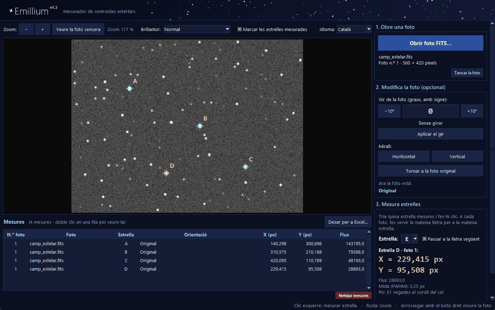
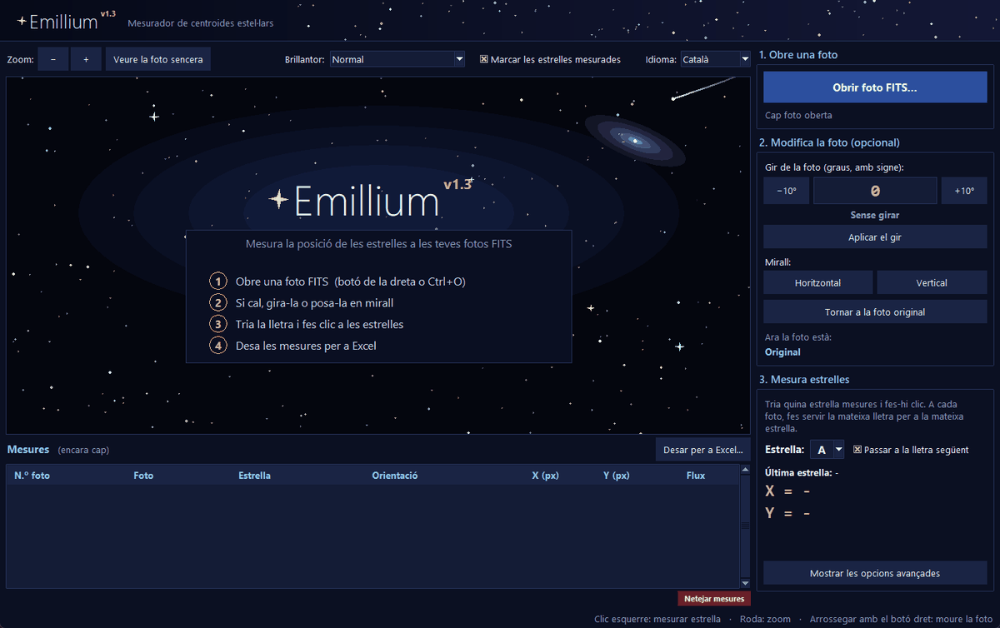

<a name="catala"></a>

<p align="center">
  
</p>

<h1 align="center">Emillium</h1>

<p align="center">
  <b>Mesurador de centroides estel·lars per a fotos astronòmiques FITS</b>
</p>

<p align="center">
  
  
  
  
  
</p>

<p align="center">
  <b>Català</b> · <a href="#castellano">Castellano</a>
</p>

<p align="center">
  
</p>

**Emillium** és un programa d'escriptori senzill en català i castellà, per mesurar la posició de
les estrelles en fotos **FITS** amb **precisió de centèsimes de píxel**. Obres una foto, fas clic a les
estrelles i obtens les seves coordenades **X i Y en píxels**, a punt per treballar-les en un Excel.

Està pensat per a **treballs escolars**, **activitats educatives** i **pràctiques d'astronomia**:
comparar la posició de les estrelles entre fotos, estrelles dobles, satèl·lits de Júpiter, moviment
d'un asteroide...

> **Senzill** — tres passos, poques opcions i una explicació a cada botó.<br>
> **Lleuger** — un sol `.exe`, sense instal·lar res (des del codi només cal `numpy`).<br>
> **Privat** — funciona sense internet i no envia cap dada.<br>
> **Obert i explicat** — el lector FITS, el gir de la foto i el càlcul del centre estan programats a mà a
> [`codigo/Emillium.py`](codigo/Emillium.py) i comentats pas a pas, sense biblioteques d'astronomia.

---

## Índex

- [Funcions](#funcions)
- [Instal·lació](#installació)
- [Com es fa servir](#com-es-fa-servir)
- [Coordenades](#coordenades)
- [Exportar a Excel](#exportar-a-excel)
- [Com es calcula el centre](#com-es-calcula-el-centre)
- [Limitacions](#limitacions)
- [Combinacions secretes](#combinacions-secretes)
- [Estructura del projecte](#estructura-del-projecte)
- [Autors i llicència](#autors-i-llicència)

---

## Funcions

| | |
|---|---|
| **Centre subpíxel** | Centre de massa de la llum de l'estrella, amb un error de centèsimes de píxel. |
| **Estrelles juntes** | Agafa l'estrella **més propera al clic** (no la més brillant) i, si en té una de brillant enganxada, li treu la llum. Si una mesura cau sobre una estrella ja mesurada amb una altra lletra, avisa. |
| **Estrelles amb lletra** | Cada estrella té una lletra (A, B, C...), la mateixa a totes les fotos, perquè sigui fàcil comparar-les. |
| **Gir i mirall** | Gir amb qualsevol angle (amb signe ben visible), botons −10° / +10°, mirall horitzontal i vertical. Les estrelles mesurades segueixen marcades. |
| **Excel** | `.xlsx` real, que funciona en qualsevol idioma: una fila per foto i columnes per estrella. També CSV. |
| **Taula clara** | Nº de foto, foto, estrella, orientació, X, Y i flux. Res més. |
| **Idiomes** | Català per defecte i castellà, canviable en qualsevol moment sense perdre res. |

---

## Instal·lació

### Opció 1 · Executable per a Windows (recomanat)

1. A l'apartat [**Releases**](../../releases), descarrega l'executable d'**Emillium**.
2. Fes-hi doble clic. No cal instal·lar res.

> [!NOTE]
> Com que el programa no està signat digitalment, la primera vegada Windows pot mostrar
> «Windows ha protegit l'equip». Prem **Més informació → Executa igualment**.

També pots arrossegar una foto FITS sobre el `.exe` per obrir-la directament.

### Opció 2 · Des del codi

Necessita **Python 3.9 o superior** (provat amb Python 3.14), amb `tkinter` (ja ve inclòs a Windows)
i `numpy`:

```bash
pip install -r codigo/requirements.txt
python codigo/Emillium.py
```

Està provat a Windows. A Linux i macOS hauria de funcionar des del codi, però encara no s'ha provat.

---

## Com es fa servir

<p align="center">
  
</p>

La finestra té un panell a la dreta amb els passos numerats. Si deixes el ratolí a sobre d'un botó,
surt una explicació.

1. **Obre una foto** amb **Obrir foto FITS…** (`Ctrl+O`).
2. *(Opcional)* **Modifica la foto**: escriu l'angle de gir amb el seu signe i prem **Aplicar el gir**, o
   posa-la en **mirall**.
3. **Mesura estrelles**: tria la **lletra** de l'estrella i fes-hi **clic**. El resultat surt en gran a la
   dreta i s'afegeix a la taula. Fes servir la mateixa lletra per a la mateixa estrella a totes les fotos.
4. **Desar per a Excel…** (`Ctrl+S`).

Per mesurar una altra foto, obre-la i repeteix els passos: les mesures s'acumulen a la taula i cada foto
rep el seu número.

<details>
<summary><b>Tots els controls</b></summary>

| Acció | Com |
|---|---|
| Obrir una foto | **Obrir foto FITS…** (o `Ctrl+O`). |
| Triar l'estrella | Desplegable **Estrella** (A, B, C...). Amb **Passar a la lletra següent**, després de mesurar passa sola a la lletra següent; en obrir una altra foto torna a la A. |
| Mesurar una estrella | **Clic esquerre** a prop de l'estrella. Si tornes a mesurar la mateixa lletra a la mateixa foto, substitueix l'anterior. |
| Zoom | Roda del ratolí, o els botons **−**, **+** i **Veure la foto sencera**. |
| Moure la foto | Arrossegar amb el **botó dret** (o la roda premuda). |
| Girar | Escriu l'angle amb signe (`+12,5`, `-7`...) i prem Intro o **Aplicar el gir**. **+** = sentit antihorari, **−** = sentit horari. **−10°** i **+10°** el canvien de 10 en 10. L'angle és sempre respecte a la foto original. |
| Mirall | **Horitzontal** (esquerra ↔ dreta) o **Vertical** (amunt ↔ avall). |
| Tornar a l'original | **Tornar a la foto original**. |
| Veure una mesura | Doble clic a la seva fila de la taula. |
| Esborrar mesures | Selecciona-les a la taula (amb `Ctrl` o `Maj` per triar-ne diverses) i prem **Esborrar la mesura** o la tecla `Supr`. `Ctrl+Z` esborra l'última. |
| Començar de zero | Botó petit i vermell **Netejar mesures**: les esborra totes (demana confirmació) i torna a numerar les fotos des de l'1. |
| Treure la foto | **Tancar la foto**: torna a la pantalla d'inici sense esborrar les mesures. |
| Canviar d'idioma | Desplegable **Idioma** (Català / Castellano). |
| Veure millor les estrelles | Desplegable **Brillantor**. Només canvia com es veu la foto, no les mesures. |

</details>

<details>
<summary><b>Opcions avançades</b></summary>

Es mostren amb el botó **Mostrar les opcions avançades**:

- **Distància màx. al clic (px)**: fins on es busca l'estrella al voltant del clic.
- **Radi per al centre (px)**: mida del cercle que es fa servir per calcular el centre. Convé que sigui
  unes 2–3 vegades la mida (FWHM) de les estrelles.
- **Llindar sobre el soroll (σ)**: quants cops ha de superar un píxel el soroll del cel per comptar en
  el centre. **Recomanat: 3.** Més baix, el soroll desvia el centre de les estrelles febles.

En canviar una opció, la mesura seleccionada (o l'última) es torna a calcular sola.

</details>

---

## Coordenades

- **X** creix cap a la dreta i **Y** cap amunt. El centre del píxel de baix a l'esquerra és (0, 0).
- Les coordenades es donen sobre la foto **tal com es veu** (després del gir i el mirall). Per això la
  taula i l'Excel guarden també l'**orientació** de cada mesura, per exemple «Mirall vertical, girada
  +25° (antihorari)». Primer s'apliquen els miralls i després el gir.
- Els girs de 90° en 90° són exactes; els altres angles interpolen els píxels i les cantonades buides
  queden sense dades.
- Les distàncies i diferències entre estrelles es calculen a l'Excel a partir de X i Y.

---

## Exportar a Excel

- **`.xlsx` (recomanat)**, amb dos fulls:
  - **Coordenades píxels**: una fila per foto amb `Nº de foto`, `Foto`, `Orientació` i, per a cada
    estrella, `A_X (px)`, `A_Y (px)`, `A_Flux`, `B_X (px)`... Si la foto té la data a la capçalera
    (`DATE-OBS`), surt també `Data i hora`. Si una estrella no es va mesurar en una foto, les seves
    caselles queden buides.
  - **Totes les mesures**: la mateixa informació en forma de llista, una fila per mesura.

  Els números es desen amb tots els decimals (a la pantalla se'n veuen 3), així que s'hi pot calcular
  directament. Funciona amb Excel en qualsevol idioma, LibreOffice i Google Sheets. La fila de títols
  queda fixa en baixar i té filtres.
- **`.csv`**: separat per `;` i amb coma decimal (Excel l'obre bé si està en català o castellà).
- Els títols de les columnes surten en l'idioma triat al programa.

---

## Com es calcula el centre

### La idea

En una foto, una estrella **no és un punt**: és una petita taca de llum que ocupa uns quants píxels,
molt brillant al mig i cada cop més fosca cap als costats. El **centre** de l'estrella és el **punt
d'equilibri** d'aquesta llum: si la taca fos una placa i cada píxel pesés tant com brilla, és el punt
on la podries aguantar amb un dit sense que caigués cap a cap costat. En física se'n diu **centre de
massa**.

Com que es fa una mitjana amb la llum de tots els píxels de la taca, el resultat pot caure **entre
dos píxels**. Per això Emillium dona posicions com `X = 229,415 px` i no només números enters.

### Un exemple amb números

Imagina una fila de tres píxels d'una estrella, ja sense la llum del cel:

| Posició del píxel | 0 | 1 | 2 |
|---|:---:|:---:|:---:|
| Llum | 10 | 30 | 20 |

El píxel més brillant és el 1, però el 2 té més llum que el 0, així que el centre ha d'estar una mica
a la dreta del 1. El centre de massa ho calcula així:

> centre = (0 × 10 + 1 × 30 + 2 × 20) / (10 + 30 + 20) = 70 / 60 = **1,167**

Emillium fa exactament això, però en dues dimensions (X i Y) i amb tots els píxels de l'estrella.

### Pas a pas

**1. Trobar l'estrella que vols.** Al voltant del clic, Emillium busca els **pics**: píxels més
brillants que els seus 8 veïns i que destaquen clarament sobre el soroll del cel. Si n'hi ha diversos,
tria **el més proper al clic**, no el més brillant. Així, si fas clic en una estrella feble que té una
de brillant al costat, la brillant no et «roba» el clic.

**2. Mesurar el cel.** El cel d'una foto mai és negre del tot: hi ha llum de la ciutat, de la Lluna, de
l'atmosfera i de la pròpia càmera. A més, cada píxel té una mica de **soroll** (petites variacions
a l'atzar). Emillium mira un **anell** de píxels al voltant de l'estrella, on ja no hi ha llum de
l'estrella, i calcula:
- el **fons**: quanta llum té el cel allà (la mediana, el valor del mig);
- el **soroll (σ)**: quant varia d'un píxel a un altre.

Abans, treu de l'anell els píxels estranys (per exemple, una altra estrella que hi caigui a sobre),
perquè no enganyin el càlcul.

**3. Comprovar que és una estrella.** Si el píxel més brillant no supera el fons en més de **llindar ×
σ** (per defecte, 3 vegades el soroll), allò no és una estrella sinó soroll, i Emillium t'avisa
en lloc de donar una posició inventada.

**4. Treure la llum de les veïnes.** Si hi ha una estrella brillant molt a prop, la seva llum es
barreja amb la de la teva i estiraria el centre cap a ella. Emillium aprofita que les estrelles són
**simètriques**: la llum de la veïna en un punt és igual que la del punt oposat respecte al seu centre.
Així pot calcular quanta llum de la veïna hi ha sobre la teva estrella i restar-la. També fa més petit
el cercle de mesura, perquè no arribi a tocar la veïna.

**5. Quedar-se només amb la llum de l'estrella.** A cada píxel se li resta el fons del cel i, a més,
el **llindar × σ**. Els píxels que queden per sota de zero no compten. Per què? Perquè a les vores de
l'estrella la llum és tan feble que es confon amb el soroll, i aquest soroll, que és a l'atzar, mouria
el centre cap a un costat o cap a l'altre. Fent servir només els píxels on l'estrella destaca de
veritat, el centre de les estrelles febles passa de tenir un error d'unes 0,4 px a unes 0,05–0,08 px.

**6. Calcular el centre i afinar-lo.** Amb els píxels que queden dins d'un **cercle** al voltant de
l'estrella (el *Radi per al centre*), es calcula el centre de massa com a l'exemple. Com que el cercle
estava centrat en el píxel més brillant i no en el centre de veritat, es torna a col·locar el cercle
sobre el centre nou i es calcula un altre cop. Es repeteix fins que el centre es mou **menys de
0,0001 píxels**, que normalment és en molt pocs passos.

**7. Comprovacions i dades extra.** Si el centre cau a menys de 1,5 px d'una estrella que ja havies
mesurat amb una altra lletra a la mateixa foto, Emillium t'avisa i no la desa (segurament has fet clic
dues vegades a la mateixa estrella). A més, et dona:
- el **flux**: tota la llum de l'estrella sumada, sense el cel;
- la **mida (FWHM)**: l'amplada de l'estrella a la meitat de la seva brillantor màxima;
- quantes vegades el **pic** de l'estrella supera el soroll del cel.

<details>
<summary><b>La fórmula</b></summary>

Per a cada píxel *i* del cercle, amb posició (x<sub>i</sub>, y<sub>i</sub>) i brillantor B<sub>i</sub>:

> w<sub>i</sub> = B<sub>i</sub> − fons − llindar · σ  (si surt negatiu, w<sub>i</sub> = 0)
>
> X = Σ x<sub>i</sub> · w<sub>i</sub> / Σ w<sub>i</sub>  Y = Σ y<sub>i</sub> · w<sub>i</sub> / Σ w<sub>i</sub>

- **Fons i σ**: mediana i desviació típica dels píxels d'un anell que va de *r* + 3 a *r* + 9 píxels del
  centre (*r* = radi per al centre), traient els valors a més de 3σ de la mediana fins que no en
  queda cap.
- **Veïna brillant** (com a mínim la meitat de brillant que la teva i a menys de *r* + 8 px): amb
  centre (x<sub>v</sub>, y<sub>v</sub>), es resta la seva llum reflectida, B(2x<sub>v</sub> − x,
  2y<sub>v</sub> − y) − fons. El radi es redueix a 0,55 vegades la distància a la veïna més propera
  (mínim 1,5 px).
- **FWHM** = 2,3548 · √(Σ w<sub>i</sub> · d<sub>i</sub>² / (2 Σ w<sub>i</sub>)), on d<sub>i</sub> és la
  distància del píxel al centre.

</details>

### Com de precís és?

Amb estrelles simulades en posicions conegudes, l'error del centre va ser d'entre **0,003 i 0,025
píxels**, és a dir, entre 3 i 25 mil·lèsimes de píxel. A les fotos reals, la precisió depèn sobretot de
com de brillant sigui l'estrella respecte al soroll del cel: com més destaqui, més precís.

---

## Limitacions

- Dona posicions **en píxels**: no calcula coordenades celestes (AR/Dec), ni incerteses, ni magnituds.
- Llegeix només la **primera imatge** del fitxer FITS, i no obre fitxers comprimits `.fz`.
- No calibra (biaix, foscos, flats) ni apila fotos.
- No recorda l'idioma ni les opcions d'una vegada per l'altra.
- Només s'ha provat a **Windows**.

---

## Combinacions secretes

<details>
<summary><b>Hi ha uns quants <i>easter eggs</i> astronòmics...</b></summary>

S'escriuen seguides (menys de 1,2 s entre tecla i tecla), sense estar escrivint en una casella.

| Tecles | Què passa | On |
|---|---|---|
| `M42` | La nebulosa d'Orió creua el cel | Pantalla d'inici |
| `618` | TON 618 fa orbitar les estrelles | Pantalla d'inici |
| `M1` o `CRAB` | Supernova, nebulosa del Cranc i un púlsar | Pantalla d'inici |
| `M16` | Els Pilars de la Creació; neixen estrelles noves | Pantalla d'inici |
| `1977` | La sonda Voyager, amb so d'espai profund | Pantalla d'inici |
| `ISS` | L'Estació Espacial Internacional creua el cel | Pantalla d'inici |
| `2001` | Homenatge a «2001: una odissea de l'espai», amb música sintetitzada a volum baix | Pantalla d'inici |
| `EARTH` | De la Terra al «punt blau pàl·lid» | Sempre |
| `6EQUJ5` o `WOW` | El senyal Wow! | Sempre |
| `SPOCK` o `VULCAN` | Salutació vulcaniana | Sempre |
| `GARGANTUA` o `INTERSTELLAR` | Lent gravitatòria (no afecta les mesures) | Sempre |
| `42` | La resposta definitiva | Sempre |

</details>

---

## Estructura del projecte

```
Emillium/
├── codigo/
│   ├── Emillium.py          # tot el programa, comentat
│   ├── Emillium.spec        # configuració per crear el .exe
│   ├── requirements.txt     # numpy
│   └── icono.ico
├── docs/                    # imatges d'aquest README
├── LICENSE
└── README.md
```

### Crear l'executable

```bash
pip install pyinstaller
cd codigo
pyinstaller Emillium.spec
```

L'`Emillium.exe` apareix a `codigo/dist/`.

---

## Autors i llicència

Fet per **Plutarco Martínez** i **Emilio Ruiz**, amb l'assistència de **Claude Code**.

Distribuït sota la [llicència MIT](LICENSE): el pots fer servir, modificar i compartir lliurement,
mantenint l'avís de llicència.

<br>

<a name="castellano"></a>

<p align="center">
  
</p>

<h1 align="center">Emillium</h1>

<p align="center">
  <b>Medidor de centroides estelares para fotos astronómicas FITS</b>
</p>

<p align="center">
  
  
  
  
  
</p>

<p align="center">
  <a href="#catala">Català</a> · <b>Castellano</b>
</p>

<p align="center">
  
</p>

**Emillium** es un programa de escritorio sencillo, en catalán y castellano, para medir la posición de
las estrellas en fotos **FITS** con **precisión de centésimas de píxel**. Abres una foto, haces clic en las
estrellas y obtienes sus coordenadas **X e Y en píxeles**, listas para trabajar con ellas en un Excel.

Está pensado para **trabajos escolares** (como un *treball de recerca*) y prácticas de astronomía:
comparar la posición de las estrellas entre fotos, estrellas dobles, satélites de Júpiter, movimiento
de un asteroide...

> **Sencillo** — tres pasos, pocas opciones y una explicación en cada botón.<br>
> **Ligero** — un solo `.exe`, sin instalar nada (desde el código solo hace falta `numpy`).<br>
> **Privado** — funciona sin internet y no envía ningún dato.<br>
> **Abierto y explicado** — el lector FITS, el giro de la foto y el cálculo del centro están programados a
> mano en [`codigo/Emillium.py`](codigo/Emillium.py) y comentados paso a paso, sin bibliotecas de astronomía.

---

## Índice

- [Funciones](#funciones)
- [Instalación](#instalación)
- [Cómo se usa](#cómo-se-usa)
- [Coordenadas](#coordenadas)
- [Exportar a Excel](#exportar-a-excel-1)
- [Cómo se calcula el centro](#cómo-se-calcula-el-centro)
- [Limitaciones](#limitaciones)
- [Combinaciones secretas](#combinaciones-secretas)
- [Estructura del proyecto](#estructura-del-proyecto)
- [Autores y licencia](#autores-y-licencia)

---

## Funciones

| | |
|---|---|
| **Centro subpíxel** | Centro de masas de la luz de la estrella, con un error de centésimas de píxel. |
| **Estrellas juntas** | Coge la estrella **más cercana al clic** (no la más brillante) y, si tiene una brillante pegada, le quita su luz. Si una medida cae sobre una estrella ya medida con otra letra, avisa. |
| **Estrellas con letra** | Cada estrella tiene una letra (A, B, C...), la misma en todas las fotos, para que sea fácil compararlas. |
| **Giro y espejo** | Giro con cualquier ángulo (con signo bien visible), botones −10° / +10°, espejo horizontal y vertical. Las estrellas medidas siguen marcadas. |
| **Excel** | `.xlsx` real, que funciona en cualquier idioma: una fila por foto y columnas por estrella. También CSV. |
| **Tabla clara** | N.º de foto, foto, estrella, orientación, X, Y y flujo. Nada más. |
| **Idiomas** | Catalán por defecto y castellano, cambiable en cualquier momento sin perder nada. |

---

## Instalación

### Opción 1 · Ejecutable para Windows (recomendado)

1. En el apartado [**Releases**](../../releases), descarga el ejecutable de **Emillium**.
2. Haz doble clic. No hace falta instalar nada.

> [!NOTE]
> Como el programa no está firmado digitalmente, la primera vez Windows puede mostrar
> «Windows protegió su PC». Pulsa **Más información → Ejecutar de todas formas**.

También puedes arrastrar una foto FITS sobre el `.exe` para abrirla directamente.

### Opción 2 · Desde el código

Necesita **Python 3.9 o superior** (probado con Python 3.14), con `tkinter` (ya viene incluido en Windows)
y `numpy`:

```bash
pip install -r codigo/requirements.txt
python codigo/Emillium.py
```

Está probado en Windows. En Linux y macOS debería funcionar desde el código, pero todavía no se ha probado.

---

## Cómo se usa

<p align="center">
  
</p>

<p align="center"><sub>La interfaz se muestra en catalán; se cambia a castellano con el desplegable «Idioma».</sub></p>

La ventana tiene un panel a la derecha con los pasos numerados. Si dejas el ratón encima de un botón,
aparece una explicación.

1. **Abre una foto** con **Abrir foto FITS…** (`Ctrl+O`).
2. *(Opcional)* **Modifica la foto**: escribe el ángulo de giro con su signo y pulsa **Aplicar el giro**, o
   ponla en **espejo**.
3. **Mide estrellas**: elige la **letra** de la estrella y haz **clic** en ella. El resultado sale en grande
   a la derecha y se añade a la tabla. Usa la misma letra para la misma estrella en todas las fotos.
4. **Guardar para Excel…** (`Ctrl+S`).

Para medir otra foto, ábrela y repite los pasos: las medidas se acumulan en la tabla y cada foto recibe
su número.

<details>
<summary><b>Todos los controles</b></summary>

| Acción | Cómo |
|---|---|
| Abrir una foto | **Abrir foto FITS…** (o `Ctrl+O`). |
| Elegir la estrella | Desplegable **Estrella** (A, B, C...). Con **Pasar a la letra siguiente**, después de medir pasa sola a la letra siguiente; al abrir otra foto vuelve a la A. |
| Medir una estrella | **Clic izquierdo** cerca de la estrella. Si vuelves a medir la misma letra en la misma foto, sustituye a la anterior. |
| Zoom | Rueda del ratón, o los botones **−**, **+** y **Ver foto entera**. |
| Mover la foto | Arrastrar con el **botón derecho** (o la rueda pulsada). |
| Girar | Escribe el ángulo con signo (`+12,5`, `-7`...) y pulsa Intro o **Aplicar el giro**. **+** = sentido antihorario, **−** = sentido horario. **−10°** y **+10°** lo cambian de 10 en 10. El ángulo es siempre respecto a la foto original. |
| Espejo | **Horizontal** (izquierda ↔ derecha) o **Vertical** (arriba ↔ abajo). |
| Volver al original | **Volver a la foto original**. |
| Ver una medida | Doble clic en su fila de la tabla. |
| Borrar medidas | Selecciónalas en la tabla (con `Ctrl` o `Mayús` para elegir varias) y pulsa **Borrar la medida** o la tecla `Supr`. `Ctrl+Z` borra la última. |
| Empezar de cero | Botón pequeño y rojo **Limpiar medidas**: las borra todas (pide confirmación) y vuelve a numerar las fotos desde el 1. |
| Quitar la foto | **Cerrar la foto**: vuelve a la pantalla de inicio sin borrar las medidas. |
| Cambiar de idioma | Desplegable **Idioma** (Català / Castellano). |
| Ver mejor las estrellas | Desplegable **Brillo**. Solo cambia cómo se ve la foto, no las medidas. |

</details>

<details>
<summary><b>Opciones avanzadas</b></summary>

Se muestran con el botón **Mostrar opciones avanzadas**:

- **Distancia máx. al clic (px)**: hasta dónde se busca la estrella alrededor del clic.
- **Radio para el centro (px)**: tamaño del círculo que se usa para calcular el centro. Conviene que sea
  unas 2–3 veces el tamaño (FWHM) de las estrellas.
- **Umbral sobre el ruido (σ)**: cuántas veces tiene que superar un píxel el ruido del cielo para contar
  en el centro. **Recomendado: 3.** Más bajo, el ruido desvía el centro de las estrellas débiles.

Al cambiar una opción, la medida seleccionada (o la última) se vuelve a calcular sola.

</details>

---

## Coordenadas

- **X** crece hacia la derecha e **Y** hacia arriba. El centro del píxel de abajo a la izquierda es (0, 0).
- Las coordenadas se dan sobre la foto **tal como se ve** (después del giro y el espejo). Por eso la tabla
  y el Excel guardan también la **orientación** de cada medida, por ejemplo «Espejo vertical, girada +25°
  (antihorario)». Primero se aplican los espejos y después el giro.
- Los giros de 90° en 90° son exactos; los demás ángulos interpolan los píxeles y las esquinas vacías
  quedan sin datos.
- Las distancias y diferencias entre estrellas se calculan en el Excel a partir de X e Y.

---

## Exportar a Excel

- **`.xlsx` (recomendado)**, con dos hojas:
  - **Coordenadas píxeles**: una fila por foto con `N.º de foto`, `Foto`, `Orientación` y, para cada
    estrella, `A_X (px)`, `A_Y (px)`, `A_Flux`, `B_X (px)`... Si la foto tiene la fecha en la cabecera
    (`DATE-OBS`), sale también la fecha y hora. Si una estrella no se midió en una foto, sus casillas
    quedan vacías.
  - **Todas las medidas**: la misma información en forma de lista, una fila por medida.

  Los números se guardan con todos sus decimales (en pantalla se ven 3), así que se puede calcular con ellos
  directamente. Funciona con Excel en cualquier idioma, LibreOffice y Google Sheets. La fila de títulos
  queda fija al bajar y tiene filtros.
- **`.csv`**: separado por `;` y con coma decimal (Excel lo abre bien si está en catalán o castellano).
- Los títulos de las columnas salen en el idioma elegido en el programa.

---

## Cómo se calcula el centro

### La idea

En una foto, una estrella **no es un punto**: es una pequeña mancha de luz que ocupa unos cuantos
píxeles, muy brillante en el medio y cada vez más oscura hacia los lados. El **centro** de la estrella es
el **punto de equilibrio** de esa luz: si la mancha fuera una placa y cada píxel pesara tanto como
brilla, es el punto donde podrías sostenerla con un dedo sin que se cayera hacia ningún lado. En física
se llama **centro de masas**.

Como se hace una media con la luz de todos los píxeles de la mancha, el resultado puede caer **entre
dos píxeles**. Por eso Emillium da posiciones como `X = 229,415 px` y no solo números enteros.

### Un ejemplo con números

Imagina una fila de tres píxeles de una estrella, ya sin la luz del cielo:

| Posición del píxel | 0 | 1 | 2 |
|---|:---:|:---:|:---:|
| Luz | 10 | 30 | 20 |

El píxel más brillante es el 1, pero el 2 tiene más luz que el 0, así que el centro tiene que estar un
poco a la derecha del 1. El centro de masas lo calcula así:

> centro = (0 × 10 + 1 × 30 + 2 × 20) / (10 + 30 + 20) = 70 / 60 = **1,167**

Emillium hace exactamente esto, pero en dos dimensiones (X e Y) y con todos los píxeles de la estrella.

### Paso a paso

**1. Encontrar la estrella que quieres.** Alrededor del clic, Emillium busca los **picos**: píxeles más
brillantes que sus 8 vecinos y que destacan claramente sobre el ruido del cielo. Si hay varios, elige
**el más cercano al clic**, no el más brillante. Así, si haces clic en una estrella débil que tiene una
brillante al lado, la brillante no te «roba» el clic.

**2. Medir el cielo.** El cielo de una foto nunca es negro del todo: hay luz de la ciudad, de la Luna, de
la atmósfera y de la propia cámara. Además, cada píxel tiene un poco de **ruido** (pequeñas variaciones
al azar). Emillium mira un **anillo** de píxeles alrededor de la estrella, donde ya no hay luz de la
estrella, y calcula:
- el **fondo**: cuánta luz tiene el cielo ahí (la mediana, el valor del medio);
- el **ruido (σ)**: cuánto varía de un píxel a otro.

Antes, quita del anillo los píxeles raros (por ejemplo, otra estrella que caiga encima), para que no
engañen al cálculo.

**3. Comprobar que es una estrella.** Si el píxel más brillante no supera el fondo en más de **umbral ×
σ** (por defecto, 3 veces el ruido), eso no es una estrella sino ruido, y Emillium te avisa en lugar de
dar una posición inventada.

**4. Quitar la luz de las vecinas.** Si hay una estrella brillante muy cerca, su luz se mezcla con la de
la tuya y tiraría del centro hacia ella. Emillium aprovecha que las estrellas son **simétricas**: la luz
de la vecina en un punto es igual que la del punto opuesto respecto a su centro. Así puede calcular
cuánta luz de la vecina hay sobre tu estrella y restarla. También hace más pequeño el círculo de medida,
para que no llegue a tocar a la vecina.

**5. Quedarse solo con la luz de la estrella.** A cada píxel se le resta el fondo del cielo y, además, el
**umbral × σ**. Los píxeles que quedan por debajo de cero no cuentan. ¿Por qué? Porque en los bordes de
la estrella la luz es tan débil que se confunde con el ruido, y ese ruido, que es al azar, movería el
centro hacia un lado o hacia el otro. Usando solo los píxeles donde la estrella destaca de verdad, el
centro de las estrellas débiles pasa de tener un error de unos 0,4 px a unos 0,05–0,08 px.

**6. Calcular el centro y afinarlo.** Con los píxeles que quedan dentro de un **círculo** alrededor de la
estrella (el *Radio para el centro*), se calcula el centro de masas como en el ejemplo. Como el círculo
estaba centrado en el píxel más brillante y no en el centro de verdad, se vuelve a colocar el círculo
sobre el centro nuevo y se calcula otra vez. Se repite hasta que el centro se mueve **menos de 0,0001
píxeles**, lo que normalmente ocurre en muy pocos pasos.

**7. Comprobaciones y datos extra.** Si el centro cae a menos de 1,5 px de una estrella que ya habías
medido con otra letra en la misma foto, Emillium te avisa y no la guarda (seguramente has hecho clic dos
veces en la misma estrella). Además, te da:
- el **flujo**: toda la luz de la estrella sumada, sin el cielo;
- el **tamaño (FWHM)**: la anchura de la estrella a la mitad de su brillo máximo;
- cuántas veces el **pico** de la estrella supera el ruido del cielo.

<details>
<summary><b>La fórmula</b></summary>

Para cada píxel *i* del círculo, con posición (x<sub>i</sub>, y<sub>i</sub>) y brillo B<sub>i</sub>:

> w<sub>i</sub> = B<sub>i</sub> − fondo − umbral · σ  (si sale negativo, w<sub>i</sub> = 0)
>
> X = Σ x<sub>i</sub> · w<sub>i</sub> / Σ w<sub>i</sub>  Y = Σ y<sub>i</sub> · w<sub>i</sub> / Σ w<sub>i</sub>

- **Fondo y σ**: mediana y desviación típica de los píxeles de un anillo que va de *r* + 3 a *r* + 9
  píxeles del centro (*r* = radio para el centro), quitando los valores a más de 3σ de la mediana hasta
  que no queda ninguno.
- **Vecina brillante** (al menos la mitad de brillante que la tuya y a menos de *r* + 8 px): con centro
  (x<sub>v</sub>, y<sub>v</sub>), se resta su luz reflejada, B(2x<sub>v</sub> − x, 2y<sub>v</sub> − y) −
  fondo. El radio se reduce a 0,55 veces la distancia a la vecina más cercana (mínimo 1,5 px).
- **FWHM** = 2,3548 · √(Σ w<sub>i</sub> · d<sub>i</sub>² / (2 Σ w<sub>i</sub>)), donde d<sub>i</sub> es la
  distancia del píxel al centro.

</details>

### ¿Cómo de preciso es?

Con estrellas simuladas en posiciones conocidas, el error del centro fue de entre **0,003 y 0,025
píxeles**, es decir, entre 3 y 25 milésimas de píxel. En las fotos reales, la precisión depende sobre todo
de lo brillante que sea la estrella respecto al ruido del cielo: cuanto más destaque, más preciso.

---

## Limitaciones

- Da posiciones **en píxeles**: no calcula coordenadas celestes (AR/Dec), ni incertidumbres, ni
  magnitudes.
- Lee solo la **primera imagen** del archivo FITS, y no abre archivos comprimidos `.fz`.
- No calibra (bias, darks, flats) ni apila fotos.
- No recuerda el idioma ni las opciones de una vez para otra.
- Solo se ha probado en **Windows**.

---

## Combinaciones secretas

<details>
<summary><b>Hay unos cuantos <i>easter eggs</i> astronómicos...</b></summary>

Se teclean seguidas (menos de 1,2 s entre tecla y tecla), sin estar escribiendo en una casilla.

| Teclas | Qué pasa | Dónde |
|---|---|---|
| `M42` | La nebulosa de Orión cruza el cielo | Pantalla de inicio |
| `618` | TON 618 hace orbitar las estrellas | Pantalla de inicio |
| `M1` o `CRAB` | Supernova, nebulosa del Cangrejo y un púlsar | Pantalla de inicio |
| `M16` | Los Pilares de la Creación; nacen estrellas nuevas | Pantalla de inicio |
| `1977` | La sonda Voyager, con sonido de espacio profundo | Pantalla de inicio |
| `ISS` | La Estación Espacial Internacional cruza el cielo | Pantalla de inicio |
| `2001` | Homenaje a «2001: una odisea del espacio», con música sintetizada a volumen bajo | Pantalla de inicio |
| `EARTH` | De la Tierra al «punto azul pálido» | Siempre |
| `6EQUJ5` o `WOW` | La señal Wow! | Siempre |
| `SPOCK` o `VULCAN` | Saludo vulcano | Siempre |
| `GARGANTUA` o `INTERSTELLAR` | Lente gravitatoria (no afecta a las medidas) | Siempre |
| `42` | La respuesta definitiva | Siempre |

</details>

---

## Estructura del proyecto

```
Emillium/
├── codigo/
│   ├── Emillium.py          # todo el programa, comentado
│   ├── Emillium.spec        # configuración para crear el .exe
│   ├── requirements.txt     # numpy
│   └── icono.ico
├── docs/                    # imágenes de este README
├── LICENSE
└── README.md
```

### Crear el ejecutable

```bash
pip install pyinstaller
cd codigo
pyinstaller Emillium.spec
```

El `Emillium.exe` aparece en `codigo/dist/`.

---

## Autores y licencia

Hecho por **Plutarco Martínez** y **Emilio Ruiz**, con la asistencia de **Claude Code**.

Distribuido bajo la [licencia MIT](LICENSE): puedes usarlo, modificarlo y compartirlo libremente,
manteniendo el aviso de licencia.
