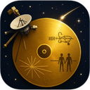
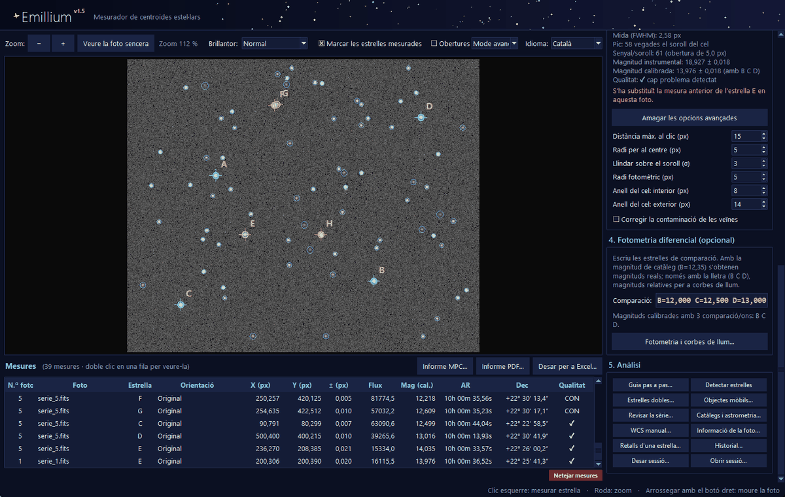
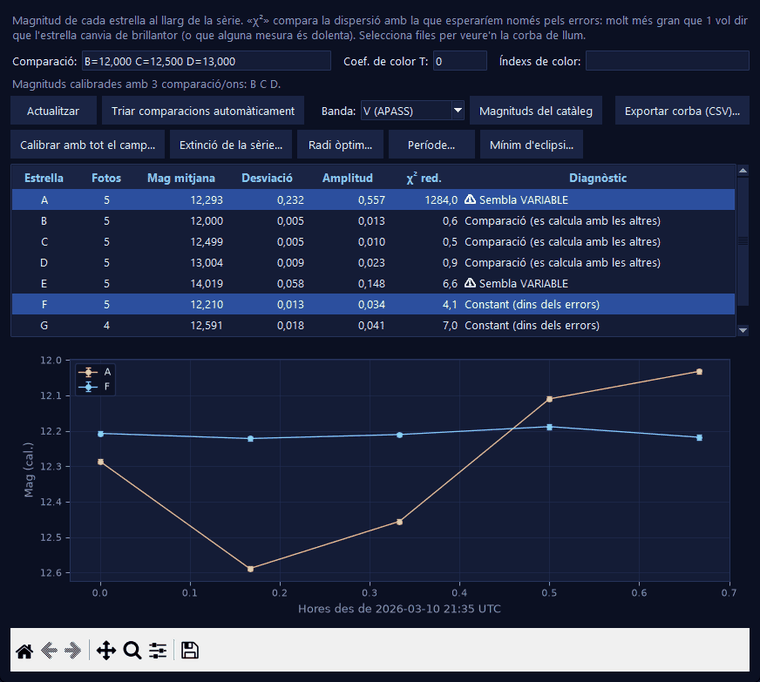
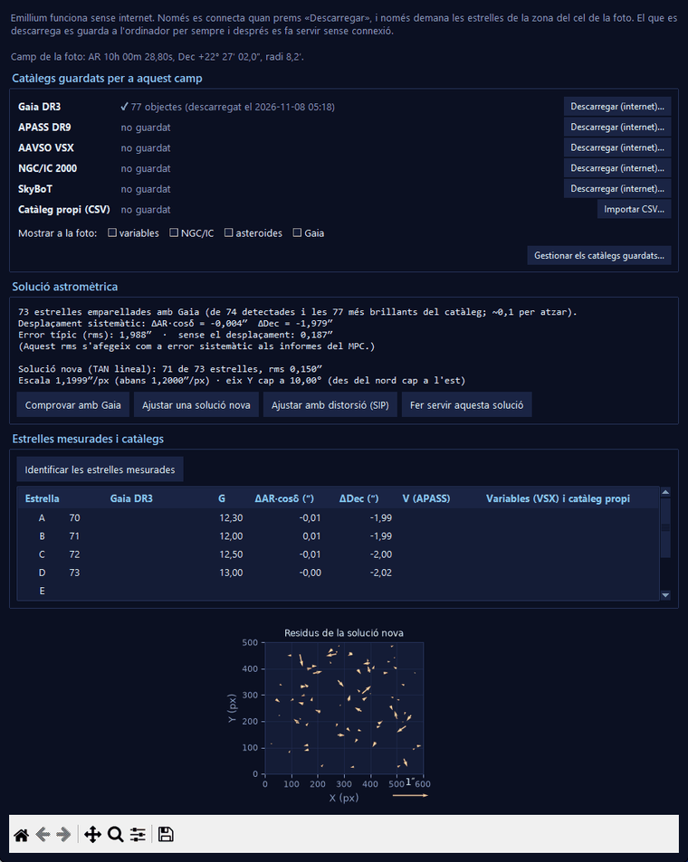
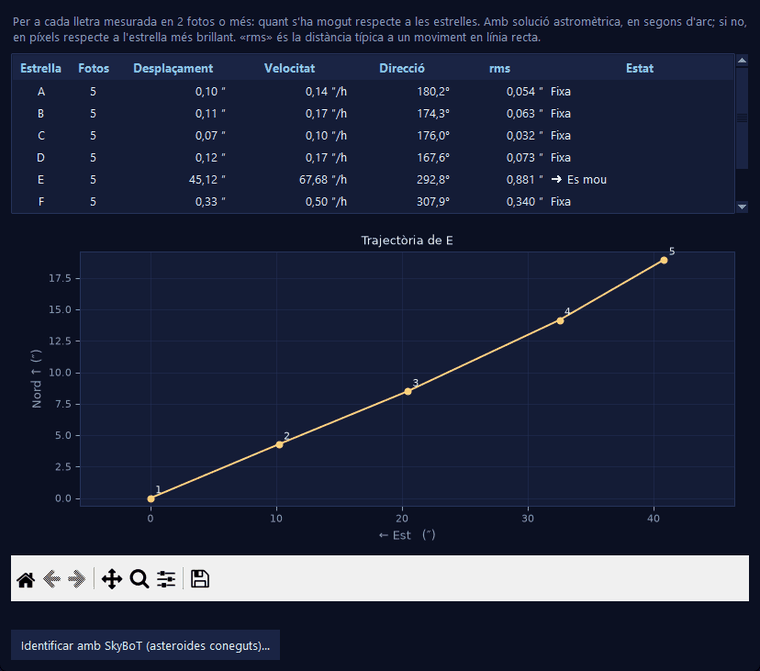
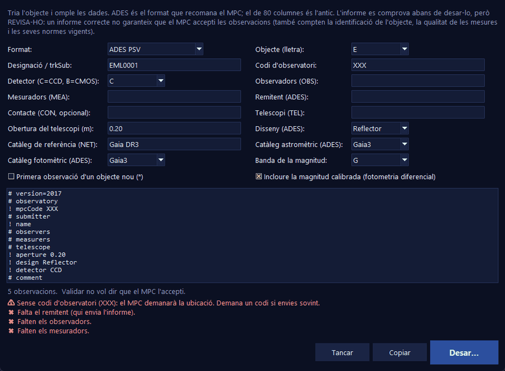
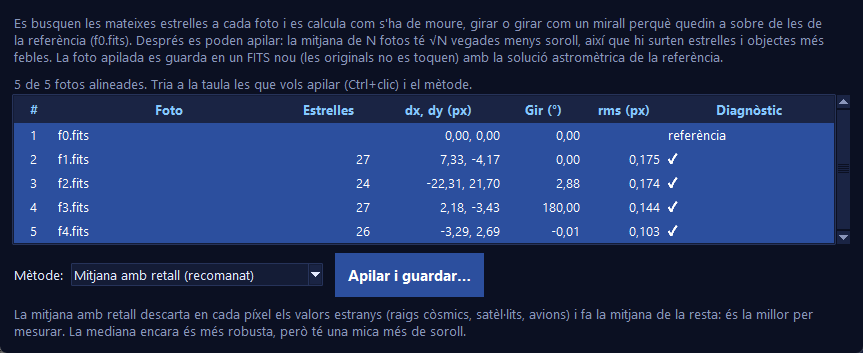

<a name="catala"></a>

<p align="center">
  
</p>

<h1 align="center">Emillium Expanded</h1>

<p align="center">
  <b>Astrometria i fotometria per a fotos astronòmiques FITS</b><br>
  <sub>Expanded · v1.5</sub>
</p>

<p align="center">
  
  
  
  
  
  
  
</p>

<p align="center">
  <b>Català</b> · <a href="#castellano">Castellano</a>
</p>

<p align="center">
  
</p>

**Emillium Expanded** és l'edició ampliada d'Emillium: mesura la posició de les estrelles en fotos
**FITS** amb **precisió de centèsimes de píxel** i hi afegeix el que cal per fer **astrometria i
fotometria** amb les teves pròpies fotos: coordenades celestes, magnituds, corbes de llum, estrelles
dobles, asteroides i informes per al Minor Planet Center.

Està pensat per a **astrònoms aficionats**: estrelles variables, eclipses, moviments propis, estrelles
dobles, seguiment d'asteroides i cometes...

> **Sense internet** — funciona sempre sense connexió; només es connecta quan tu prems «Descarregar».<br>
> **Transparent** — tots els càlculs estan programats a mà i explicats pas a pas al codi i aquí.<br>
> **Comprovat** — amb un conjunt de fotos de referència, proves automàtiques i fotos reals de la NASA.

---

## Índex

- [Novetats de la 1.5](#novetats-de-la-15)
- [Funcions](#funcions)
- [Captures](#captures)
- [Sense internet](#sense-internet)
- [Instal·lació](#installació)
- [Guia ràpida](#guia-ràpida)
- [Precisió i validació](#precisió-i-validació)
- [Limitacions](#limitacions)
- [Resolució de problemes](#resolució-de-problemes)
- [Com es calcula](#com-es-calcula)
- [Estructura del projecte](#estructura-del-projecte)
- [Autors i llicència](#autors-i-llicència)

---

## Novetats de la 1.5

- **Informes ADES** (PSV i XML), el format que recomana el MPC, amb **validació** abans de desar.
- **Fotometria d'obertura configurable**, **diverses estrelles de comparació**, **corbes de llum**,
  **detecció d'estrelles variables** i correcció de color.
- **Indicadors de qualitat** a cada mesura: saturada, contaminada, a la vora, S/R baix, mida estranya, allargada.
- **Detecció automàtica d'estrelles**, **estrelles dobles** (separació i angle de posició) i
  **objectes mòbils** (velocitat, direcció i seguiment automàtic entre fotos).
- **Catàlegs** Gaia DR3, APASS, AAVSO VSX i SkyBoT, **descarregats només quan tu vols** i guardats per sempre.
- **Resoldre fotos sense solució astromètrica** amb Gaia (sabent més o menys cap on apuntaven), i
  **comprovar, ajustar o calcular** la solució.
- **Revisió de sèries**: fotos desenfocades, mogudes, amb núvols o desalineades; **mesurar tota la sèrie** d'un
  clic; **parpelleig**; i **cerca automàtica d'objectes mòbils**, també els desconeguts.
- **Calibració amb tot el camp** (punt zero i terme de color), **coeficient d'extinció** i **radi d'obertura òptim**.
- **Objectes de cel profund** (NGC/IC) i **marques dels catàlegs** a sobre de la foto.
- **Fitxers amb diverses imatges** (extensions o plans, com les 4 càmeres de WFPC2).
- **Mode senzill i avançat**, **informació de la foto** (capçalera, estadístiques, histograma), **historial**,
  **guia pas a pas** i **informe PDF**.
- **Estrelles variables i eclipsis**: **temps baricèntric (BJD<sub>TDB</sub>)** i heliocèntric (HJD), **cerca del
  període** (Lomb-Scargle) amb corba en fase i **instant del mínim** d'un eclipsi (Kwee-van Woerden).
- **Alinear i apilar fotos**: alinea tota la sèrie amb precisió de centèsimes de píxel (també girada o en
  mirall) i la suma en una foto nova amb menys soroll, sense raigs còsmics ni satèl·lits. El parpelleig també
  fa servir aquest alineat.
- **Solució astromètrica amb distorsió (SIP)**, **correcció de la contaminació** de les veïnes, **retalls** d'una
  estrella a totes les fotos, fitxers **`.fits.gz`** i **gestor dels catàlegs guardats**.
- **Detecció automàtica més fiable**: mesura el fons i el soroll per zones (els degradats i les nebuloses ja no
  creen estrelles falses), ignora les zones sense dades de fora del camp i descarta rètols, blocs brillants i
  línies rectes, i els anells i les aspes de les estrelles brillants.
- **Més ràpid i estable**: una foto de 24 MP s'obre en 0,1 s i les estrelles es detecten en menys d'1 s, amb 4
  vegades menys memoria; els errors inesperats s'avisen i es guarden en un registre sense tancar el programa.
- **Sessions**: desa tota la feina i continua un altre dia.
- **Conjunt de fotos de referència i proves de regressió** per comprovar la precisió.

## Funcions

| | |
|---|---|
| **Centre subpíxel** | Centre de massa iteratiu amb llindar sobre el soroll. Agafa l'estrella **més propera al clic** i, si en té una de brillant enganxada, li treu la llum. Funciona també amb estrelles saturades. |
| **Incertesa** | ± en X, Y, flux i magnitud de cada mesura. Als informes s'hi afegeix l'error sistemàtic de la solució astromètrica (si s'ha comprovat amb Gaia). |
| **Fotometria** | Obertura circular de radi configurable, amb l'àrea exacta dels píxels de la vora i el cel en un anell. **Fotometria diferencial** amb una o diverses comparacions (calibrada o relativa), **terme de color** opcional, **corbes de llum** i **χ² de variabilitat**. |
| **Qualitat** | Cada mesura diu si està saturada (`SAT`), contaminada per una veïna (`CON`), a la vora (`BOR`), amb S/R baix (`SNR`), amb una mida estranya (`FWHM`) o allargada (`ELO`). |
| **Coordenades celestes** | **AR i Dec** amb la solució astromètrica de la foto (TAN, amb o sense **SIP**). Es pot **comprovar amb Gaia DR3**, **ajustar-ne una de nova** o **calcular-la amb 3 estrelles conegudes**. |
| **Catàlegs** | **Gaia DR3** (posicions portades a la data de la foto amb el moviment propi), **APASS** (magnituds B, V, g′, r′, i′), **AAVSO VSX** (variables), **NGC/IC** (cel profund) i **SkyBoT** (asteroides i cometes coneguts). També catàlegs propis en CSV. Es poden **marcar a sobre de la foto**. |
| **Resoldre la foto** | Sense solució astromètrica, però sabent més o menys cap on apuntava el telescopi (de la capçalera o escrit), Emillium la troba comparant els **triangles** que formen les estrelles amb els de Gaia. Funciona girada, en mirall i fins i tot sense saber l'escala. |
| **Variables i eclipsis** | **BJD<sub>TDB</sub>** (temps baricèntric, l'estàndard actual) i **HJD** (heliocèntric), a menys de 0,1 s d'astropy, **període** amb el periodograma de Lomb-Scargle i la corba de llum en fase, i **instant del mínim** d'un eclipsi amb el seu error (Kwee-van Woerden). |
| **Calibració** | **Punt zero i terme de color** ajustats amb totes les estrelles del camp que són al catàleg; **coeficient d'extinció** amb la massa d'aire de cada foto; **radi òptim** amb la corba de creixement. |
| **Estrelles dobles** | Separació (″ o px) i angle de posició a cada foto, amb la mitjana i el seu error, i gràfics. |
| **Objectes mòbils** | Quines estrelles es mouen respecte a les altres, a quina velocitat i cap on. «Mesurar com a la foto anterior» busca l'asteroide **on ha de ser**. Identificació amb SkyBoT. |
| **Sèries de fotos** | ◀ ▶ entre fotos, **Mesurar tota la sèrie** d'un clic, **Parpelleig** (dues fotos alineades alternant-se), **Alinear i apilar** (desplaçament, gir i mirall; mitjana amb retall o mediana, guardada en un FITS nou amb la solució astromètrica) i **Revisar la sèrie**: fons, soroll, estrelles, FWHM, allargament i desplaçament de cada foto, amb les dolentes marcades i **cerca automàtica d'objectes mòbils**. |
| **Interfície** | **Mode senzill** (només el bàsic) o **avançat**, **obertures** dibuixades amb colors segons la qualitat, **informació de la foto** (capçalera FITS, estadístiques i histograma), **historial** de les operacions i **guia pas a pas**. Fitxers amb **diverses imatges** (◀ ▶ «Imatge»). |
| **Temps** | Hora UTC del **mig de l'exposició** i **dia julià**, també amb formats antics (`DD/MM/AA`, hora en decimals) i fitxers amb la data a la capçalera principal. |
| **Informes MPC** | **ADES** (PSV i XML) o **80 columnes**, amb vista prèvia i validació: codis, dates, rangs, errors de posició i moviment coherent. |
| **FITS** | Normals i **`.fz`** comprimits (RICE_1, GZIP_1, GZIP_2), extensions, BZERO/BSCALE/BLANK. Protecció contra fitxers manipulats. |
| **Excel i PDF** | `.xlsx` amb una fila per foto (amb JD, HJD i BJD<sub>TDB</sub>) i columnes per estrella, totes les mesures, la revisió de la sèrie, la **configuració** usada (per poder repetir-ho) i l'historial. També CSV. **Informe PDF** amb resum, mesures, corbes de llum, objectes mòbils i revisió. |
| **Sessions** | Desa i recupera fotos, mesures, comparacions, opcions i solucions astromètriques ajustades. |

## Captures

<table>
  <tr>
    <td width="50%"></td>
    <td></td>
  </tr>
  <tr>
    <td align="center"><sub>Fotometria: corba de llum d'una variable</sub></td>
    <td align="center"><sub>Catàlegs i comprovació de la solució astromètrica</sub></td>
  </tr>
  <tr>
    <td></td>
    <td></td>
  </tr>
  <tr>
    <td align="center"><sub>Trajectòria d'un asteroide</sub></td>
    <td align="center"><sub>Informe ADES amb validació</sub></td>
  </tr>
  <tr>
    <td colspan="2" align="center"></td>
  </tr>
  <tr>
    <td colspan="2" align="center"><sub>Alinear i apilar: 5 fotos desplaçades, girades i a 180°</sub></td>
  </tr>
</table>

---

## Sense internet

El funcionament **sense connexió** és un requisit del projecte:

- **Cap funció principal necessita internet.** Obrir, mesurar, fotometria, astrometria, informes i Excel
  funcionen sempre sense connexió.
- Emillium **només es connecta quan prems «Descarregar»** a la finestra de catàlegs (o «Identificar amb
  SkyBoT»). Abans et diu a quin servidor es connectarà i què s'envia: **només la zona del cel** (AR, Dec i radi).
- El que es descarrega **es guarda a l'ordinador per sempre** (`%APPDATA%\Emillium\catalogos`) i es fa
  servir sense tornar-se a connectar.
- **Sense telemetria** ni consultes automàtiques en segon pla.

---

## Instal·lació

### Opció 1 · Executable per a Windows (recomanat)

1. A l'apartat [**Releases**](../../releases), descarrega `EmilliumExpanded.exe` (~44 MB).
2. Fes-hi doble clic. No cal instal·lar res.

> [!NOTE]
> Com que el programa no està signat digitalment, la primera vegada Windows pot mostrar
> «Windows ha protegit l'equip». Prem **Més informació → Executa igualment**.

### Opció 2 · Des del codi

Necessita **Python 3.9 o superior** (provat amb Python 3.14), amb `tkinter` (ja ve inclòs a Windows),
`numpy` i `matplotlib` (només per als gràfics):

```bash
pip install -r codigo/requirements.txt
python codigo/Emillium.py
```

Està provat a Windows. A Linux i macOS hauria de funcionar des del codi, però encara no s'ha provat.

---

## Guia ràpida

1. **Obrir foto FITS…** (`Ctrl+O`). Pots triar-ne diverses alhora per treballar amb una sèrie.
2. *(Opcional)* Gira-la o posa-la en mirall.
3. Tria la **lletra** de l'estrella (A, B, C...) i fes-hi **clic**. Mira la columna **Qualitat**.
4. Passa a la foto següent (▶) i prem **Mesurar com a la foto anterior**. Els asteroides es busquen on han de ser.
   Amb una sèrie oberta també hi ha **Mesurar tota la sèrie**, **Parpelleig** i **Alinear i apilar…**
5. *(Opcional)* A **Fotometria diferencial**, escriu les comparacions: `B=12,35 C=11,90 D=13,10`
   (o només `B C D` per a magnituds relatives) i obre **Fotometria i corbes de llum…**
6. *(Opcional)* A **5. Anàlisi**: estrelles dobles, objectes mòbils, revisar la sèrie, catàlegs i astrometria
   (també per **resoldre** una foto sense solució astromètrica).
7. **Desar per a Excel…** (`Ctrl+S`), **Informe PDF…**, **Informe MPC…** o **Desar sessió…**

Si comences, prem **Guia pas a pas…** (panell 5): una llista que es marca sola. I si et sobren eines, tria
**Mode senzill** a dalt.

<details>
<summary><b>Ratolí i dreceres de teclat</b></summary>

| Acció | Ratolí / tecla |
|---|---|
| Mesurar una estrella | Clic esquerre |
| Zoom | Roda del ratolí (a sobre del panell dret, el desplaça) |
| Moure la foto | Arrossegar amb el botó dret |
| Foto anterior / següent | `RePàg` / `AvPàg` |
| Esborrar les mesures seleccionades | `Supr` |
| Esborrar l'última mesura | `Ctrl+Z` |
| Obrir / desar | `Ctrl+O` / `Ctrl+S` |

</details>

<details>
<summary><b>Opcions avançades</b></summary>

- **Distància màx. al clic (px)**: fins on es busca l'estrella.
- **Radi per al centre (px)**: unes 2–3 vegades la FWHM de les estrelles.
- **Llindar sobre el soroll (σ)**: quins píxels compten per al centre. **Recomanat: 3.**
- **Radi fotomètric (px)**: on se suma la llum de l'estrella. Fes servir el mateix per a totes; un bon
  valor és 1,5–2 vegades la FWHM.
- **Anell del cel (interior i exterior)**: on es mesura el fons, fora de l'estrella.

En canviar una opció, la mesura seleccionada (o l'última) es torna a calcular sola.

</details>

**Coordenades en píxels:** X cap a la dreta i Y cap amunt; el centre del píxel de baix a l'esquerra és
(0, 0). Es donen sobre la foto **tal com es veu** (després del gir i el mirall). La fotometria i les
AR/Dec sempre es calculen sobre la foto original, així que no depenen del gir.

---

## Precisió i validació

### Com es comprova

| Què | Amb què |
|---|---|
| **Conjunt de referència** | 17 fotos FITS simulades amb la veritat coneguda ([`proves/referencia`](proves/referencia)): estrelles brillants, febles, dobles, una variable, un asteroide, una foto desenfocada, un camp dens i dues escales de píxel. Les condicions de cada cas són a [`generar_referencia.py`](proves/generar_referencia.py) i a `referencia.json`. |
| **Proves automàtiques** | [`prova_regressio.py`](proves/prova_regressio.py) les mesura i acaba amb error si alguna cosa empitjora. [`prova_precisio.py`](proves/prova_precisio.py) prova el lector FITS, el gir, les coordenades i el dia julià. |
| **astropy** | Píxels, AR/Dec, dia julià, fitxers `.fz`, separacions i angles de posició comparats amb [astropy](https://www.astropy.org). |
| **Dades reals independents** | [`prova_reals.py`](proves/prova_reals.py) compara amb astropy qualsevol carpeta de fotos FITS reals (píxels, temps i AR/Dec de cada imatge i pla). Amb les fotos de la NASA: 16 imatges, totes idèntiques. |
| **Rendiment i estabilitat** | Fotos de 24 MP, fitxers trencats o manipulats, imatges buides, constants, de 3×3 o d'una fila, sessions i catàlegs corruptes: cap tanca el programa. |
| **Fotos reals** | Imatges de l'HST (FOC, NICMOS, WFPC2), UIT i EUVE de la NASA, i Gaia DR3 real. |

Les proves separen tres coses diferents:

- **Exactitud**: quant s'allunya el resultat de la veritat.
- **Repetibilitat**: quant varia si es repeteix amb un altre soroll, i si el ± que dona Emillium ho prediu bé.
- **Precisió numèrica**: si el càlcul dona exactament el mateix cada vegada i el mateix punt quan es gira la foto.

### Resultats

| Prova | Resultat |
|---|---|
| Centre d'estrelles brillants | error ≤ **0,006 px** (± predit 0,005 px) |
| Centre d'estrelles febles (S/R 10–30) | error ≤ 0,18 px, sempre dins de 3 vegades el ± predit |
| Repetibilitat (60 sorolls diferents) | dispersió real / ± predit = **0,81** (centre) i **1,09** (flux) |
| Precisió numèrica | girant la foto 90°, el mateix punt a 3·10⁻¹⁴ px; píxel → cel → píxel a 10⁻⁷ px |
| AR/Dec | **0,004″** de diferència màxima amb astropy (3.000 punts); 0,025″ de la veritat amb 0,6 i 3″/px |
| Estrelles dobles a 5–8 px | separació a ≤ 0,02″ i angle a ≤ 0,3° de la veritat; marcades com a contaminades |
| Variable amb 3 comparacions | magnitud a ≤ **0,003 mag** de la veritat; detectada com a variable |
| Asteroide | velocitat a un 0,2 % de la veritat i direcció a 0,2° |
| Comprovació amb Gaia | un error de 2″ a la solució astromètrica es detecta i, en ajustar-la, l'error baixa a 0,02–0,04″ |
| Camp dens (400 estrelles) | el **92 %** de les estrelles separables trobades, cap detecció falsa |
| Detecció en fotos difícils | amb un degradat fort, un bloc brillant, una línia, zones sense dades i una estrella amb anell i aspes: totes les estrelles trobades i **cap detecció falsa**; 0–2 falses per megapíxel en una foto de només soroll |
| Foto desenfocada | detectada (FWHM 6,5 px davant de 3,1) |
| Dia julià i formats antics | ≤ 0,5 ms amb astropy, també amb `DD/MM/AA` i hora en decimals |
| Fitxers `.fz` | **idèntics** a astropy en 20 combinacions |
| Resoldre una foto sense WCS | camp dens resolt **sense saber l'escala** i amb 30″ d'error d'apuntat: 256 estrelles, 0,03″ d'error a les cantonades; fotos girades i en mirall, resoltes en 1–12 s |
| Cerca automàtica d'objectes mòbils | l'asteroide de la sèrie de referència trobat sol, a 0,13 px de la veritat |
| Calibració amb el camp | punt zero a 0,002 mag de la veritat; terme de color recuperat (0,121 per 0,12) i variables descartades |
| Coeficient d'extinció | 0,211 per 0,21 de la veritat |
| Temps heliocèntric (HJD) | ≤ 0,06 s d'astropy en 200 casos |
| Temps baricèntric (BJD<sub>TDB</sub>) | ≤ 0,07 s d'astropy (de 1982 a 2026) |
| Període d'una variable | 0,3712 d trobat amb un error < 0,1 % (dades de 5 nits) |
| Mínim d'eclipsi | a 2–3 s de la veritat, amb un error predit semblant |
| Distorsió (SIP) | rms de 2,6″ (lineal) a 0,2″ (soroll de la simulació) |
| Correcció de la contaminació | flux d'una estrella amb una veïna a 5 px: de +41 % a −1 % |
| Alinear fotos | desplaçades, girades, a 180° i en mirall: alineades a ≤ **0,08 px** |
| Apilar 5 fotos | soroll del cel 3 vegades més baix, raig còsmic eliminat, flux de les estrelles conservat a 0,007 mag, mateixa solució astromètrica |
| Fotos reals de la NASA | píxels idèntics a astropy i AR/Dec iguals (< 0,001 mil·lisegons d'arc); els 4 plans de WFPC2 |

Per repetir-ho tot (només cal `numpy`):

```bash
python proves/prova_precisio.py
python proves/prova_regressio.py
python proves/prova_reals.py CARPETA_AMB_FITS   # amb astropy
```

Si canvies el codi i alguna prova falla, has empitjorat alguna cosa. Per tornar a crear les fotos de
referència: `python proves/generar_referencia.py`.

---

## Limitacions

**Fotos i coordenades**

- **No resol l'astrometria del tot a cegues**: per resoldre una foto amb Gaia cal saber més o menys cap on
  apuntava el telescopi (a la capçalera o escrit) i haver descarregat Gaia per a aquella zona. Sense això,
  cal una foto ja resolta o conèixer 3 estrelles (WCS manual).
- La solució que **ajusta** Emillium pot ser lineal (TAN) o amb distorsió (SIP, si hi ha prou estrelles); en
  substituir la de la foto, compara els rms abans d'aplicar-la.
- Les AR/Dec només surten amb solucions TAN o TAN-SIP (no TPV, ZPN...).
- Considera que `DATE-OBS` és l'**inici** de l'exposició.
- Llegeix la **primera imatge** del fitxer (en color, la mitjana dels plans; amb més plans, el primer).
- No llegeix **HCOMPRESS_1** ni **PLIO_1**, i no calibra (biaix, foscos, flats).
- **Apilar** és per a fotos de la mateixa càmera (es fa servir gir + escala + desplaçament) i amb estrelles
  en comú. La interpolació (bilineal) eixampla una mica les estrelles: el flux dins d'una obertura petita baixa
  ~0,5 % (igual per a totes, així que la fotometria diferencial no se n'adona). Els objectes que es mouen
  (asteroides) surten borrosos o desapareixen: mesura'ls a les fotos originals.

**Mesures**

- La **detecció automàtica** no separa estrelles a menys de ~2 vegades la FWHM (es veuen com una sola).
  Mesurant-les amb un clic sí que se separen. Tampoc distingeix un rètol borrós (com els números de les
  plaques fotogràfiques antigues) d'una estrella.
- Fotometria d'**obertura** (no ajust de PSF). L'extinció atmosfèrica de primer ordre es cancel·la dins de
  cada foto; no hi ha transformació completa al sistema estàndard, només el terme de color si escrius
  el coeficient i els índexs.
- La comprovació amb Gaia necessita estrelles semblants a les del visible: en fotos ultraviolades
  (com les de l'UIT) en troba molt poques.
- En **camps molt densos**, les estrelles febles que no es detecten però cauen dins de l'obertura fan que
  algunes estrelles semblin més brillants. La calibració amb el camp descarta les que tenen veïnes visibles.
- El **BJD<sub>TDB</sub>** fa servir les òrbites mitjanes dels planetes gegants (no una efemèride completa):
  error de mil·lisegons a dècimes de segon, de sobra per a eclipsis amb fotos d'aficionat.
- El **període** pot sortir com un «àlies» si les fotos són de nits a la mateixa hora; i la **correcció de la
  contaminació** suposa estrelles gaussianes (és aproximada).
- **Amb un clic, Emillium mesura qualsevol taca de llum**, encara que no sigui una estrella (un rètol, un
  reflex, un defecte). Fixa't en la columna **Qualitat**: `CON` o `BOR` volen dir que alguna cosa no quadra.
- Màxim 26 estrelles amb lletra (A–Z) per foto.

**Informes i validació**

- ADES versió 2017. Un informe vàlid **no garanteix** que el MPC l'accepti: també compten la identificació
  de l'objecte, la qualitat de les mesures i les seves normes vigents.
- Validat amb astropy, simulacions i fotos reals; **encara no s'ha comparat amb AstroImageJ**.

**Sistema**

- Només s'ha provat a **Windows** (vegeu [Resolució de problemes](#resolució-de-problemes) per a Linux i macOS). L'executable ocupa ~44 MB (per matplotlib).

> [!IMPORTANT]
> Abans d'enviar cap informe al Minor Planet Center, revisa'l i consulta les instruccions vigents
> a la [web del MPC](https://minorplanetcenter.net).

---

## Com es calcula

### El centre de cada estrella

En una foto, una estrella **no és un punt**: és una petita taca de llum que ocupa uns quants píxels.
El **centre** és el **punt d'equilibri** d'aquesta llum (el **centre de massa**): si cada píxel pesés tant com
brilla, és on aguantaries la taca amb un dit. Com que és una mitjana de molts píxels, pot caure **entre
dos píxels** (per exemple `X = 229,415 px`).

<details>
<summary><b>Pas a pas i fórmules</b></summary>

1. **Trobar l'estrella**: el pic més proper al clic entre els que destaquen sobre el soroll. Els píxels
   iguals del centre d'una estrella saturada compten com una sola estrella.
2. **Mesurar el cel** en un anell al voltant (mediana i σ, traient els valors estranys a 3σ).
3. **Comprovar** que el pic supera el fons en més de llindar × σ.
4. **Treure la llum de les veïnes brillants** aprofitant que les estrelles són simètriques.
5. **Quedar-se amb la llum de l'estrella**: w<sub>i</sub> = B<sub>i</sub> − fons − llindar · σ (els negatius no compten).
6. **Centre de massa** X = Σ x<sub>i</sub> w<sub>i</sub> / Σ w<sub>i</sub>, recentrant el cercle fins que es mou menys de 0,0001 px.
7. **Incertesa**: σ<sub>X</sub>² = Σ (x<sub>i</sub> − X)² σ<sub>i</sub>² / (Σ w<sub>i</sub>)², amb σ<sub>i</sub>² = σ² (+ llum / `GAIN`).

</details>

### Fotometria

- **Obertura**: es suma la llum dins d'un cercle de radi *r*. Els píxels de la vora compten només la part
  que queda dins (cada píxel es divideix en 5 × 5 trossets). El fons es mesura en un anell i es resta.
  Error: σ<sub>F</sub>² = N σ² (1 + N / N<sub>anell</sub>) + F / `GAIN`.
- **Magnitud instrumental**: m = 25 − 2,5 log<sub>10</sub>(F / t), error 1,0857 σ<sub>F</sub> / F.
- **Diverses comparacions**: cada comparació *c* dona un punt zero ZP<sub>c</sub> = M<sub>c</sub> − m<sub>c</sub> − T · IC<sub>c</sub>;
  es fa la mitjana ponderada i M = m + ZP + T · IC. Si alguna no té magnitud de catàleg, el resultat és
  relatiu a la mitjana de les comparacions. Una comparació es calcula amb les altres (serveix de control).
- **Variabilitat**: χ² reduït d'una recta horitzontal amb els errors de cada punt. Variable si χ² > 5, hi ha
  5 fotos o més i l'amplitud supera 5 vegades l'error típic.
- **Contaminació**: es busquen pics veïns a menys de *r* + 2·FWHM i s'estima quina part de la seva llum cau
  dins de l'obertura (suposant una estrella gaussiana).
- **Saturació**: el valor `SATURATE` de la capçalera o el màxim dels enters (65535 a 16 bits).

### Astrometria i catàlegs

- **AR/Dec**: píxel → distorsió SIP → matriu CD → projecció gnomònica inversa. La inversa (cel → píxel) es
  fa invertint la matriu i corregint la SIP per iteracions.
- **Gaia**: posicions a l'època 2016,0 portades a la data de la foto amb el moviment propi. Per emparellar,
  només les estrelles de Gaia més brillants (unes 3 per estrella detectada), primer amb un radi ample per
  trobar el desplaçament i després amb un radi fi. Es diu quantes parelles sortirien per atzar.
- **Ajust de la solució**: es projecten les estrelles del catàleg al pla tangent i s'ajusta per mínims
  quadrats ξ = CD<sub>11</sub> u + CD<sub>12</sub> v + ξ<sub>0</sub>, η = CD<sub>21</sub> u + CD<sub>22</sub> v + η<sub>0</sub>,
  movent el punt de tangència fins que no es mou i descartant parelles a més de 3σ.
- **Estrelles dobles**: separació i angle de posició (del nord cap a l'est) amb la fórmula de Vincenty;
  els angles es fan la mitjana com a vectors (359° i 1° fan 0°).
- **Objectes mòbils**: posicions corregides foto a foto amb les altres estrelles (així un error de la solució
  d'una foto no sembla moviment) i ajust d'un moviment rectilini uniforme.
- **Informes**: l'error de cada posició és el del centre (passat a ″) combinat amb l'error sistemàtic de la
  solució astromètrica, si s'ha comprovat amb Gaia.

- **Resoldre una foto**: es fan tots els triangles de les 25 estrelles més brillants de la foto i de les 60
  més brillants de Gaia dins del camp. La forma d'un triangle (costats a ≤ b ≤ c → a/c i b/c) no canvia
  amb el gir, el mirall ni l'escala. Cada parella de triangles amb la mateixa forma proposa una
  transformació; guanya la que fa coincidir més estrelles, i s'afina amb totes. Sense escala coneguda, es
  proven escales de 0,35 a 10″/px i es queda la que n'emparella més.
- **Calibració amb el camp**: m<sub>catàleg</sub> − m<sub>inst</sub> = ZP + T · color, per mínims quadrats ponderats
  amb totes les estrelles no saturades, sense veïnes i amb S/R > 20, descartant les que s'aparten més de
  3σ (robusta, amb la MAD).
- **Extinció**: ZP(X) = ZP<sub>0</sub> − k · X amb el punt zero i la massa d'aire X de cada foto
  (`AIRMASS`, o calculada amb l'altura).
- **Radi òptim**: corba de creixement (flux i S/R amb radis de 1 a *r*<sub>anell</sub>) i el radi amb més S/R.

### Temps i variables

- **HJD**: HJD = JD − (r/c)·[cos δ cos α cos L + (sin ε sin δ + cos ε cos δ sin α) sin L], amb la posició del Sol
  de Meeus (L, r) portada a J2000.
- **BJD<sub>TDB</sub>**: BJD = JD<sub>UTC</sub> + (TT − UTC) + (TDB − TT) + (**r**<sub>Terra</sub> · **n**) / c. TT − UTC surt de la
  taula de segons intercalars (+32,184 s); **r**<sub>Terra</sub> és la posició de la Terra respecte al **baricentre**
  del sistema solar: la del Sol (Meeus) més el moviment del Sol causat per Júpiter, Saturn, Urà i Neptú
  (elements orbitals mitjans del JPL); **n** és la direcció de l'estrella.
- **Període**: periodograma de Lomb-Scargle generalitzat (amb pesos i mitjana lliure).
- **Mínim**: Kwee-van Woerden: per a cada instant de prova es reflecteix la corba i es mesura la diferència entre
  la baixada i la pujada; una paràbola en aquesta diferència dona l'instant i el seu error.
- **SIP**: ξ(u, v) i η(u, v) s'ajusten com a polinomis complets; la part lineal és la matriu CD i la resta,
  passada per CD<sup>−1</sup>, els coeficients SIP.

### Sèries

- **Detecció d'estrelles**: es treuen les zones sense dades (quadrats de 5 × 5 píxels idèntics); el fons i el
  soroll es mesuren **per caixes** de 32–64 px (així un degradat o una nebulosa no fan estrelles falses);
  imatge suavitzada 3 × 3 i màxims locals per sobre de 5σ. Es descarten els objectes plans o extensos (encara
  brillants a 6, 10 i 15 px), les línies rectes i els grumolls dels anells i les aspes de les estrelles
  brillants (tenen una còpia just a l'altra banda). Posició amb una finestra de 5 × 5 (el centre de la
  «meseta» en les saturades) i forma amb una d'11 × 11.
- **Fotos dolentes**: FWHM més d'1,5 vegades la mediana (desenfocada), estrelles allargades (moguda), menys
  de la meitat d'estrelles (núvols) o fons molt més alt (Lluna, alba).
- **Desplaçament entre fotos**: totes les parelles de les estrelles més brillants «voten» el desplaçament.
- **Alinear**: centre fi de les 100 estrelles més brillants (centre de massa iteratiu amb pes gaussià);
  triangles com en resoldre una foto (la forma no canvia amb el gir ni el mirall); la millor proposta
  s'afina per mínims quadrats amb un gir + escala + desplaçament (4 nombres), descartant les parelles a més
  de 3σ.
- **Apilar**: cada foto es porta a la graella de la referència amb interpolació bilineal, s'iguala el fons i,
  píxel a píxel, es fa la **mitjana amb retall** (es treuen els valors a més de 3σ de la mediana, amb σ la
  dispersió entre fotos i com a mínim el soroll del cel) o la **mediana**. La capçalera és la de la
  referència amb `NCOMBINE`, l'exposició mitjana (`EXPTIME`, i la total a `TOTEXP`), la ganància × N i el
  `DATE-OBS` perquè el mig de l'exposició sigui la mitjana dels de les fotos.
- **Cerca d'objectes mòbils**: tot es passa a les coordenades de la primera foto; es treuen les fonts quietes
  (presents al mateix lloc en la meitat de les fotos o més); amb les que queden, cada parella de la primera
  i l'última foto proposa una velocitat, i es busca l'objecte on hauria de ser a les fotos del mig.

<details>
<summary><b>Seguretat i privacitat</b></summary>

- Només es connecta a internet quan prems un botó de descàrrega, i només envia la zona del cel.
- Només llegeix les fotos que obres i escriu on tu dius (Excel, CSV, informes, sessions), més els
  ajustos i els catàlegs a `%APPDATA%\Emillium`.
- Els FITS manipulats (mides negatives o enormes) es rebutgen, i els textos que van al CSV es
  protegeixen contra la «injecció de fórmules».

</details>

<details>
<summary><b>Combinacions secretes</b></summary>

Hi ha uns quants *easter eggs* astronòmics. Prova d'escriure a la pantalla d'inici `M42`, `618`, `M1`,
`M16`, `1977`, `2001`, `ISS`, `EARTH`, `WOW`, `SPOCK`, `GARGANTUA` o `42`...

</details>

---

## Resolució de problemes

| Problema | Què fer |
|---|---|
| Windows diu «Windows ha protegit l'equip» | **Més informació → Executa igualment** (el programa no està signat). |
| La foto no s'obre | Llegeix l'avís: diu si el fitxer està incomplet, no és FITS o fa servir una compressió que no es pot llegir (HCOMPRESS/PLIO → `funpack`). |
| No surten AR/Dec | La foto no té solució astromètrica: resol-la a **Catàlegs i astrometria** (amb Gaia) o amb **WCS manual**. |
| «Aquí no hi ha cap estrella clara» | Fes clic més a prop, o baixa el **Llindar sobre el soroll** a les opcions avançades. |
| No es pot descarregar un catàleg | Cal internet només aquell moment; si un servidor no respon, es prova un altre mirall. Torna-ho a provar més tard. |
| No es resol la foto | Comprova l'AR/Dec aproximades, descarrega una zona més gran de Gaia o prova sense escala. |
| Alguna cosa ha fallat | El programa continua obert i el detall queda a `%APPDATA%\Emillium\errores.log`. |
| Començar de zero amb les opcions | Esborra `%APPDATA%\Emillium\ajustes.json`. |

**Linux i macOS** (des del codi; encara no s'ha provat): cal Python amb `tkinter` (a Linux, per exemple
`sudo apt install python3-tk`) i després `pip install -r codigo/requirements.txt`. Els ajustos i els
catàlegs es guarden a `~/.config/Emillium`. Els sons dels *easter eggs* només sonen a Windows.

---

## Estructura del projecte

```
Emillium1.5/
├── codigo/
│   ├── Emillium.py            # la finestra i tot el programa, comentat
│   ├── ciencia.py             # fotometria, detecció, dobles, WCS, mòbils, qualitat
│   ├── ades.py                # informes ADES i la seva validació
│   ├── catalogos.py           # Gaia, APASS, VSX, SkyBoT i catàlegs propis (amb memòria local)
│   ├── Emillium.spec          # configuració per crear el .exe
│   ├── requirements.txt       # numpy, matplotlib
│   └── icono.ico
├── proves/
│   ├── prova_precisio.py      # lector FITS, gir, coordenades, dia julià
│   ├── prova_regressio.py     # proves amb el conjunt de referència
│   ├── prova_reals.py         # comparació amb astropy en fotos reals
│   ├── generar_referencia.py  # crea el conjunt de referència
│   └── referencia/            # 17 fotos FITS + referencia.json (la veritat)
├── docs/                      # imatges d'aquest README
├── LICENSE
└── README.md
```

### Crear l'executable

```bash
pip install pyinstaller
cd codigo
pyinstaller Emillium.spec
```

L'`EmilliumExpanded.exe` apareix a `codigo/dist/`.

---

## Autors i llicència

Fet per **Plutarco Martínez** i **Emilio Ruiz**.

Distribuït sota la [llicència MIT](LICENSE): el pots fer servir, modificar i compartir lliurement,
mantenint l'avís de llicència.

---

<br>

<a name="castellano"></a>

<p align="center">
  
</p>

<h1 align="center">Emillium Expanded</h1>

<p align="center">
  <b>Astrometría y fotometría para fotos astronómicas FITS</b><br>
  <sub>Expanded · v1.5</sub>
</p>

<p align="center">
  
  
  
  
  
  
  
</p>

<p align="center">
  <a href="#catala">Català</a> · <b>Castellano</b>
</p>

<p align="center">
  
</p>

**Emillium Expanded** es la edición ampliada de Emillium: mide la posición de las estrellas en fotos
**FITS** con **precisión de centésimas de píxel** y añade lo necesario para hacer **astrometría y
fotometría** con tus propias fotos: coordenadas celestes, magnitudes, curvas de luz, estrellas dobles,
asteroides e informes para el Minor Planet Center.

Está pensado para **astrónomos aficionados**: estrellas variables, eclipses, movimientos propios,
estrellas dobles, seguimiento de asteroides y cometas...

> **Sin internet** — funciona siempre sin conexión; solo se conecta cuando tú pulsas «Descargar».<br>
> **Transparente** — todos los cálculos están programados a mano y explicados paso a paso en el código y aquí.<br>
> **Comprobado** — con un conjunto de fotos de referencia, pruebas automáticas y fotos reales de la NASA.

---

## Índice

- [Novedades de la 1.5](#novedades-de-la-15)
- [Funciones](#funciones)
- [Capturas](#capturas)
- [Sin internet](#sin-internet)
- [Instalación](#instalación)
- [Guía rápida](#guía-rápida)
- [Precisión y validación](#precisión-y-validación)
- [Limitaciones](#limitaciones)
- [Resolución de problemas](#resolución-de-problemas)
- [Cómo se calcula](#cómo-se-calcula)
- [Estructura del proyecto](#estructura-del-proyecto)
- [Autores y licencia](#autores-y-licencia)

---

## Novedades de la 1.5

- **Informes ADES** (PSV y XML), el formato que recomienda el MPC, con **validación** antes de guardar.
- **Fotometría de apertura configurable**, **varias estrellas de comparación**, **curvas de luz**,
  **detección de estrellas variables** y corrección de color.
- **Indicadores de calidad** en cada medida: saturada, contaminada, en el borde, S/R baja, tamaño raro, alargada.
- **Detección automática de estrellas**, **estrellas dobles** (separación y ángulo de posición) y
  **objetos móviles** (velocidad, dirección y seguimiento automático entre fotos).
- **Catálogos** Gaia DR3, APASS, AAVSO VSX y SkyBoT, **descargados solo cuando tú quieres** y guardados para siempre.
- **Resolver fotos sin solución astrométrica** con Gaia (sabiendo más o menos hacia dónde apuntaban), y
  **comprobar, ajustar o calcular** la solución.
- **Revisión de series**: fotos desenfocadas, movidas, con nubes o desalineadas; **medir toda la serie** de un
  clic; **parpadeo**; y **búsqueda automática de objetos móviles**, también los desconocidos.
- **Calibración con todo el campo** (punto cero y término de color), **coeficiente de extinción** y **radio de apertura óptimo**.
- **Objetos de cielo profundo** (NGC/IC) y **marcas de los catálogos** sobre la foto.
- **Archivos con varias imágenes** (extensiones o planos, como las 4 cámaras de WFPC2).
- **Modo sencillo y avanzado**, **información de la foto** (cabecera, estadísticas, histograma), **historial**,
  **guía paso a paso** e **informe PDF**.
- **Estrellas variables y eclipses**: **tiempo baricéntrico (BJD<sub>TDB</sub>)** y heliocéntrico (HJD), **búsqueda
  del periodo** (Lomb-Scargle) con curva en fase e **instante del mínimo** de un eclipse (Kwee-van Woerden).
- **Alinear y apilar fotos**: alinea toda la serie con precisión de centésimas de píxel (también girada o en
  espejo) y la suma en una foto nueva con menos ruido, sin rayos cósmicos ni satélites. El parpadeo también
  usa este alineado.
- **Solución astrométrica con distorsión (SIP)**, **corrección de la contaminación** de las vecinas, **recortes** de
  una estrella en todas las fotos, archivos **`.fits.gz`** y **gestor de los catálogos guardados**.
- **Detección automática más fiable**: mide el fondo y el ruido por zonas (los degradados y las nebulosas ya no
  crean estrellas falsas), ignora las zonas sin datos de fuera del campo y descarta rótulos, bloques brillantes y
  líneas rectas, y los anillos y las aspas de las estrellas brillantes.
- **Más rápido y estable**: una foto de 24 MP se abre en 0,1 s y las estrellas se detectan en menos de 1 s, con 4
  veces menos memoria; los errores inesperados se avisan y se guardan en un registro sin cerrar el programa.
- **Sesiones**: guarda todo el trabajo y sigue otro día.
- **Conjunto de fotos de referencia y pruebas de regresión** para comprobar la precisión.

## Funciones

| | |
|---|---|
| **Centro subpíxel** | Centro de masas iterativo con umbral sobre el ruido. Coge la estrella **más cercana al clic** y, si tiene una brillante pegada, le quita su luz. Funciona también con estrellas saturadas. |
| **Incertidumbre** | ± en X, Y, flujo y magnitud de cada medida. En los informes se añade el error sistemático de la solución astrométrica (si se ha comprobado con Gaia). |
| **Fotometría** | Apertura circular de radio configurable, con el área exacta de los píxeles del borde y el cielo en un anillo. **Fotometría diferencial** con una o varias comparaciones (calibrada o relativa), **término de color** opcional, **curvas de luz** y **χ² de variabilidad**. |
| **Calidad** | Cada medida dice si está saturada (`SAT`), contaminada por una vecina (`CON`), en el borde (`BOR`), con S/R baja (`SNR`), con un tamaño raro (`FWHM`) o alargada (`ELO`). |
| **Coordenadas celestes** | **AR y Dec** con la solución astrométrica de la foto (TAN, con o sin **SIP**). Se puede **comprobar con Gaia DR3**, **ajustar una nueva** o **calcularla con 3 estrellas conocidas**. |
| **Catálogos** | **Gaia DR3** (posiciones llevadas a la fecha de la foto con el movimiento propio), **APASS** (magnitudes B, V, g′, r′, i′), **AAVSO VSX** (variables), **NGC/IC** (cielo profundo) y **SkyBoT** (asteroides y cometas conocidos). También catálogos propios en CSV. Se pueden **marcar sobre la foto**. |
| **Resolver la foto** | Sin solución astrométrica, pero sabiendo más o menos hacia dónde apuntaba el telescopio (de la cabecera o escrito), Emillium la encuentra comparando los **triángulos** que forman las estrellas con los de Gaia. Funciona girada, en espejo e incluso sin saber la escala. |
| **Variables y eclipses** | **BJD<sub>TDB</sub>** (tiempo baricéntrico, el estándar actual) y **HJD** (heliocéntrico), a menos de 0,1 s de astropy, **periodo** con el periodograma de Lomb-Scargle y la curva de luz en fase, e **instante del mínimo** de un eclipse con su error (Kwee-van Woerden). |
| **Calibración** | **Punto cero y término de color** ajustados con todas las estrellas del campo que están en el catálogo; **coeficiente de extinción** con la masa de aire de cada foto; **radio óptimo** con la curva de crecimiento. |
| **Estrellas dobles** | Separación (″ o px) y ángulo de posición en cada foto, con la media y su error, y gráficos. |
| **Objetos móviles** | Qué estrellas se mueven respecto a las demás, a qué velocidad y hacia dónde. «Medir como en la foto anterior» busca el asteroide **donde tiene que estar**. Identificación con SkyBoT. |
| **Series de fotos** | ◀ ▶ entre fotos, **Medir toda la serie** de un clic, **Parpadeo** (dos fotos alineadas alternándose), **Alinear y apilar** (desplazamiento, giro y espejo; media con recorte o mediana, guardada en un FITS nuevo con la solución astrométrica) y **Revisar la serie**: fondo, ruido, estrellas, FWHM, alargamiento y desplazamiento de cada foto, con las malas marcadas y **búsqueda automática de objetos móviles**. |
| **Interfaz** | **Modo sencillo** (solo lo básico) o **avanzado**, **aperturas** dibujadas con colores según la calidad, **información de la foto** (cabecera FITS, estadísticas e histograma), **historial** de las operaciones y **guía paso a paso**. Archivos con **varias imágenes** (◀ ▶ «Imagen»). |
| **Tiempo** | Hora UTC del **centro de la exposición** y **día juliano**, también con formatos antiguos (`DD/MM/AA`, hora en decimales) y archivos con la fecha en la cabecera principal. |
| **Informes MPC** | **ADES** (PSV y XML) o **80 columnas**, con vista previa y validación: códigos, fechas, rangos, errores de posición y movimiento coherente. |
| **FITS** | Normales y **`.fz`** comprimidos (RICE_1, GZIP_1, GZIP_2), extensiones, BZERO/BSCALE/BLANK. Protección contra archivos manipulados. |
| **Excel y PDF** | `.xlsx` con una fila por foto (con JD, HJD y BJD<sub>TDB</sub>) y columnas por estrella, todas las medidas, la revisión de la serie, la **configuración** usada (para poder repetirlo) y el historial. También CSV. **Informe PDF** con resumen, medidas, curvas de luz, objetos móviles y revisión. |
| **Sesiones** | Guarda y recupera fotos, medidas, comparaciones, opciones y soluciones astrométricas ajustadas. |

## Capturas

<table>
  <tr>
    <td width="50%"></td>
    <td></td>
  </tr>
  <tr>
    <td align="center"><sub>Fotometría: curva de luz de una variable</sub></td>
    <td align="center"><sub>Catálogos y comprobación de la solución astrométrica</sub></td>
  </tr>
  <tr>
    <td></td>
    <td></td>
  </tr>
  <tr>
    <td align="center"><sub>Trayectoria de un asteroide</sub></td>
    <td align="center"><sub>Informe ADES con validación</sub></td>
  </tr>
  <tr>
    <td colspan="2" align="center"></td>
  </tr>
  <tr>
    <td colspan="2" align="center"><sub>Alinear y apilar: 5 fotos desplazadas, giradas y a 180°</sub></td>
  </tr>
</table>

<p align="center"><sub>La interfaz se muestra en catalán; se cambia a castellano con el desplegable «Idioma».</sub></p>

---

## Sin internet

El funcionamiento **sin conexión** es un requisito del proyecto:

- **Ninguna función principal necesita internet.** Abrir, medir, fotometría, astrometría, informes y Excel
  funcionan siempre sin conexión.
- Emillium **solo se conecta cuando pulsas «Descargar»** en la ventana de catálogos (o «Identificar con
  SkyBoT»). Antes te dice a qué servidor se conectará y qué se envía: **solo la zona del cielo** (AR, Dec y radio).
- Lo que se descarga **se guarda en el ordenador para siempre** (`%APPDATA%\Emillium\catalogos`) y se usa
  sin volver a conectarse.
- **Sin telemetría** ni consultas automáticas en segundo plano.

---

## Instalación

### Opción 1 · Ejecutable para Windows (recomendado)

1. En el apartado [**Releases**](../../releases), descarga `EmilliumExpanded.exe` (~44 MB).
2. Haz doble clic. No hace falta instalar nada.

> [!NOTE]
> Como el programa no está firmado digitalmente, la primera vez Windows puede mostrar
> «Windows protegió su PC». Pulsa **Más información → Ejecutar de todas formas**.

### Opción 2 · Desde el código

Necesita **Python 3.9 o superior** (probado con Python 3.14), con `tkinter` (ya viene incluido en Windows),
`numpy` y `matplotlib` (solo para los gráficos):

```bash
pip install -r codigo/requirements.txt
python codigo/Emillium.py
```

Está probado en Windows. En Linux y macOS debería funcionar desde el código, pero todavía no se ha probado.

---

## Guía rápida

1. **Abrir foto FITS…** (`Ctrl+O`). Puedes elegir varias a la vez para trabajar con una serie.
2. *(Opcional)* Gírala o ponla en espejo.
3. Elige la **letra** de la estrella (A, B, C...) y haz **clic** en ella. Mira la columna **Calidad**.
4. Pasa a la foto siguiente (▶) y pulsa **Medir como en la foto anterior**. Los asteroides se buscan donde tienen que estar.
   Con una serie abierta también están **Medir toda la serie**, **Parpadeo** y **Alinear y apilar…**
5. *(Opcional)* En **Fotometría diferencial**, escribe las comparaciones: `B=12,35 C=11,90 D=13,10`
   (o solo `B C D` para magnitudes relativas) y abre **Fotometría y curvas de luz…**
6. *(Opcional)* En **5. Análisis**: estrellas dobles, objetos móviles, revisar la serie, catálogos y astrometría
   (también para **resolver** una foto sin solución astrométrica).
7. **Guardar para Excel…** (`Ctrl+S`), **Informe PDF…**, **Informe MPC…** o **Guardar sesión…**

Si empiezas, pulsa **Guía paso a paso…** (panel 5): una lista que se marca sola. Y si te sobran herramientas,
elige **Modo sencillo** arriba.

<details>
<summary><b>Ratón y atajos de teclado</b></summary>

| Acción | Ratón / tecla |
|---|---|
| Medir una estrella | Clic izquierdo |
| Zoom | Rueda del ratón (encima del panel derecho, lo desplaza) |
| Mover la foto | Arrastrar con el botón derecho |
| Foto anterior / siguiente | `RePág` / `AvPág` |
| Borrar las medidas seleccionadas | `Supr` |
| Borrar la última medida | `Ctrl+Z` |
| Abrir / guardar | `Ctrl+O` / `Ctrl+S` |

</details>

<details>
<summary><b>Opciones avanzadas</b></summary>

- **Distancia máx. al clic (px)**: hasta dónde se busca la estrella.
- **Radio para el centro (px)**: unas 2–3 veces la FWHM de las estrellas.
- **Umbral sobre el ruido (σ)**: qué píxeles cuentan para el centro. **Recomendado: 3.**
- **Radio fotométrico (px)**: donde se suma la luz de la estrella. Usa el mismo para todas; un buen
  valor es 1,5–2 veces la FWHM.
- **Anillo del cielo (interior y exterior)**: donde se mide el fondo, fuera de la estrella.

Al cambiar una opción, la medida seleccionada (o la última) se vuelve a calcular sola.

</details>

**Coordenadas en píxeles:** X hacia la derecha e Y hacia arriba; el centro del píxel de abajo a la izquierda es
(0, 0). Se dan sobre la foto **tal como se ve** (después del giro y el espejo). La fotometría y las AR/Dec
siempre se calculan sobre la foto original, así que no dependen del giro.

---

## Precisión y validación

### Cómo se comprueba

| Qué | Con qué |
|---|---|
| **Conjunto de referencia** | 17 fotos FITS simuladas con la verdad conocida ([`proves/referencia`](proves/referencia)): estrellas brillantes, débiles, dobles, una variable, un asteroide, una foto desenfocada, un campo denso y dos escalas de píxel. Las condiciones de cada caso están en [`generar_referencia.py`](proves/generar_referencia.py) y en `referencia.json`. |
| **Pruebas automáticas** | [`prova_regressio.py`](proves/prova_regressio.py) las mide y termina con error si algo empeora. [`prova_precisio.py`](proves/prova_precisio.py) prueba el lector FITS, el giro, las coordenadas y el día juliano. |
| **astropy** | Píxeles, AR/Dec, día juliano, archivos `.fz`, separaciones y ángulos de posición comparados con [astropy](https://www.astropy.org). |
| **Datos reales independientes** | [`prova_reals.py`](proves/prova_reals.py) compara con astropy cualquier carpeta de fotos FITS reales (píxeles, tiempo y AR/Dec de cada imagen y plano). Con las fotos de la NASA: 16 imágenes, todas idénticas. |
| **Rendimiento y estabilidad** | Fotos de 24 MP, archivos rotos o manipulados, imágenes vacías, constantes, de 3×3 o de una fila, sesiones y catálogos corruptos: ninguno cierra el programa. |
| **Fotos reales** | Imágenes del HST (FOC, NICMOS, WFPC2), UIT y EUVE de la NASA, y Gaia DR3 real. |

Las pruebas separan tres cosas distintas:

- **Exactitud**: cuánto se aleja el resultado de la verdad.
- **Repetibilidad**: cuánto varía si se repite con otro ruido, y si el ± que da Emillium lo predice bien.
- **Precisión numérica**: si el cálculo da exactamente lo mismo cada vez y el mismo punto al girar la foto.

### Resultados

| Prueba | Resultado |
|---|---|
| Centro de estrellas brillantes | error ≤ **0,006 px** (± predicho 0,005 px) |
| Centro de estrellas débiles (S/R 10–30) | error ≤ 0,18 px, siempre dentro de 3 veces el ± predicho |
| Repetibilidad (60 ruidos distintos) | dispersión real / ± predicho = **0,81** (centro) y **1,09** (flujo) |
| Precisión numérica | girando la foto 90°, el mismo punto a 3·10⁻¹⁴ px; píxel → cielo → píxel a 10⁻⁷ px |
| AR/Dec | **0,004″** de diferencia máxima con astropy (3.000 puntos); 0,025″ de la verdad con 0,6 y 3″/px |
| Estrellas dobles a 5–8 px | separación a ≤ 0,02″ y ángulo a ≤ 0,3° de la verdad; marcadas como contaminadas |
| Variable con 3 comparaciones | magnitud a ≤ **0,003 mag** de la verdad; detectada como variable |
| Asteroide | velocidad a un 0,2 % de la verdad y dirección a 0,2° |
| Comprobación con Gaia | un error de 2″ en la solución astrométrica se detecta y, al ajustarla, el error baja a 0,02–0,04″ |
| Campo denso (400 estrellas) | el **92 %** de las estrellas separables encontradas, ninguna detección falsa |
| Detección en fotos difíciles | con un degradado fuerte, un bloque brillante, una línea, zonas sin datos y una estrella con anillo y aspas: todas las estrellas encontradas y **ninguna detección falsa**; 0–2 falsas por megapíxel en una foto de solo ruido |
| Foto desenfocada | detectada (FWHM 6,5 px frente a 3,1) |
| Día juliano y formatos antiguos | ≤ 0,5 ms con astropy, también con `DD/MM/AA` y hora en decimales |
| Archivos `.fz` | **idénticos** a astropy en 20 combinaciones |
| Resolver una foto sin WCS | campo denso resuelto **sin saber la escala** y con 30″ de error de apuntado: 256 estrellas, 0,03″ de error en las esquinas; fotos giradas y en espejo, resueltas en 1–12 s |
| Búsqueda automática de objetos móviles | el asteroide de la serie de referencia encontrado solo, a 0,13 px de la verdad |
| Calibración con el campo | punto cero a 0,002 mag de la verdad; término de color recuperado (0,121 para 0,12) y variables descartadas |
| Coeficiente de extinción | 0,211 para 0,21 de la verdad |
| Tiempo heliocéntrico (HJD) | ≤ 0,06 s de astropy en 200 casos |
| Tiempo baricéntrico (BJD<sub>TDB</sub>) | ≤ 0,07 s de astropy (de 1982 a 2026) |
| Periodo de una variable | 0,3712 d encontrado con un error < 0,1 % (datos de 5 noches) |
| Mínimo de eclipse | a 2–3 s de la verdad, con un error predicho parecido |
| Distorsión (SIP) | rms de 2,6″ (lineal) a 0,2″ (ruido de la simulación) |
| Corrección de la contaminación | flujo de una estrella con una vecina a 5 px: de +41 % a −1 % |
| Alinear fotos | desplazadas, giradas, a 180° y en espejo: alineadas a ≤ **0,08 px** |
| Apilar 5 fotos | ruido del cielo 3 veces más bajo, rayo cósmico eliminado, flujo de las estrellas conservado a 0,007 mag, misma solución astrométrica |
| Fotos reales de la NASA | píxeles idénticos a astropy y AR/Dec iguales (< 0,001 milisegundos de arco); los 4 planos de WFPC2 |

Para repetirlo todo (solo hace falta `numpy`):

```bash
python proves/prova_precisio.py
python proves/prova_regressio.py
python proves/prova_reals.py CARPETA_CON_FITS   # con astropy
```

Si cambias el código y alguna prueba falla, has empeorado algo. Para volver a crear las fotos de
referencia: `python proves/generar_referencia.py`.

---

## Limitaciones

**Fotos y coordenadas**

- **No resuelve la astrometría del todo a ciegas**: para resolver una foto con Gaia hace falta saber más o menos
  hacia dónde apuntaba el telescopio (en la cabecera o escrito) y haber descargado Gaia para esa zona. Sin eso,
  hace falta una foto ya resuelta o conocer 3 estrellas (WCS manual).
- La solución que **ajusta** Emillium puede ser lineal (TAN) o con distorsión (SIP, si hay suficientes
  estrellas); al sustituir la de la foto, compara los rms antes de aplicarla.
- Las AR/Dec solo salen con soluciones TAN o TAN-SIP (no TPV, ZPN...).
- Considera que `DATE-OBS` es el **inicio** de la exposición.
- Lee la **primera imagen** del archivo (en color, la media de los planos; con más planos, el primero).
- No lee **HCOMPRESS_1** ni **PLIO_1**, y no calibra (bias, darks, flats).
- **Apilar** es para fotos de la misma cámara (se usa giro + escala + desplazamiento) y con estrellas en
  común. La interpolación (bilineal) ensancha un poco las estrellas: el flujo dentro de una apertura pequeña
  baja ~0,5 % (igual para todas, así que la fotometría diferencial no lo nota). Los objetos que se mueven
  (asteroides) salen borrosos o desaparecen: mídelos en las fotos originales.

**Medidas**

- La **detección automática** no separa estrellas a menos de ~2 veces la FWHM (se ven como una sola).
  Midiéndolas con un clic sí se separan. Tampoco distingue un rótulo borroso (como los números de las placas
  fotográficas antiguas) de una estrella.
- Fotometría de **apertura** (no ajuste de PSF). La extinción atmosférica de primer orden se cancela dentro
  de cada foto; no hay transformación completa al sistema estándar, solo el término de color si escribes
  el coeficiente y los índices.
- La comprobación con Gaia necesita estrellas parecidas a las del visible: en fotos ultravioletas
  (como las del UIT) encuentra muy pocas.
- En **campos muy densos**, las estrellas débiles que no se detectan pero caen dentro de la apertura hacen que
  algunas estrellas parezcan más brillantes. La calibración con el campo descarta las que tienen vecinas visibles.
- El **BJD<sub>TDB</sub>** usa las órbitas medias de los planetas gigantes (no una efeméride completa): error de
  milisegundos a décimas de segundo, de sobra para eclipses con fotos de aficionado.
- El **periodo** puede salir como un «alias» si las fotos son de noches a la misma hora; y la **corrección de la
  contaminación** supone estrellas gaussianas (es aproximada).
- **Con un clic, Emillium mide cualquier mancha de luz**, aunque no sea una estrella (un rótulo, un reflejo,
  un defecto). Fíjate en la columna **Calidad**: `CON` o `BOR` quieren decir que algo no cuadra.
- Máximo 26 estrellas con letra (A–Z) por foto.

**Informes y validación**

- ADES versión 2017. Un informe válido **no garantiza** que el MPC lo acepte: también cuentan la
  identificación del objeto, la calidad de las medidas y sus normas vigentes.
- Validado con astropy, simulaciones y fotos reales; **todavía no se ha comparado con AstroImageJ**.

**Sistema**

- Solo se ha probado en **Windows** (ver [Resolución de problemas](#resolución-de-problemas) para Linux y macOS). El ejecutable ocupa ~44 MB (por matplotlib).

> [!IMPORTANT]
> Antes de enviar ningún informe al Minor Planet Center, revísalo y consulta las instrucciones vigentes
> en la [web del MPC](https://minorplanetcenter.net).

---

## Cómo se calcula

### El centro de cada estrella

En una foto, una estrella **no es un punto**: es una pequeña mancha de luz que ocupa unos cuantos píxeles.
El **centro** es el **punto de equilibrio** de esa luz (el **centro de masas**): si cada píxel pesara tanto
como brilla, es donde sostendrías la mancha con un dedo. Como es una media de muchos píxeles, puede caer
**entre dos píxeles** (por ejemplo `X = 229,415 px`).

<details>
<summary><b>Paso a paso y fórmulas</b></summary>

1. **Encontrar la estrella**: el pico más cercano al clic entre los que destacan sobre el ruido. Los
   píxeles iguales del centro de una estrella saturada cuentan como una sola estrella.
2. **Medir el cielo** en un anillo alrededor (mediana y σ, quitando los valores raros a 3σ).
3. **Comprobar** que el pico supera el fondo en más de umbral × σ.
4. **Quitar la luz de las vecinas brillantes** aprovechando que las estrellas son simétricas.
5. **Quedarse con la luz de la estrella**: w<sub>i</sub> = B<sub>i</sub> − fondo − umbral · σ (los negativos no cuentan).
6. **Centro de masas** X = Σ x<sub>i</sub> w<sub>i</sub> / Σ w<sub>i</sub>, recentrando el círculo hasta que se mueve menos de 0,0001 px.
7. **Incertidumbre**: σ<sub>X</sub>² = Σ (x<sub>i</sub> − X)² σ<sub>i</sub>² / (Σ w<sub>i</sub>)², con σ<sub>i</sub>² = σ² (+ luz / `GAIN`).

</details>

### Fotometría

- **Apertura**: se suma la luz dentro de un círculo de radio *r*. Los píxeles del borde cuentan solo la parte
  que queda dentro (cada píxel se divide en 5 × 5 trocitos). El fondo se mide en un anillo y se resta.
  Error: σ<sub>F</sub>² = N σ² (1 + N / N<sub>anillo</sub>) + F / `GAIN`.
- **Magnitud instrumental**: m = 25 − 2,5 log<sub>10</sub>(F / t), error 1,0857 σ<sub>F</sub> / F.
- **Varias comparaciones**: cada comparación *c* da un punto cero ZP<sub>c</sub> = M<sub>c</sub> − m<sub>c</sub> − T · IC<sub>c</sub>;
  se hace la media ponderada y M = m + ZP + T · IC. Si alguna no tiene magnitud de catálogo, el resultado
  es relativo a la media de las comparaciones. Una comparación se calcula con las demás (sirve de control).
- **Variabilidad**: χ² reducido de una recta horizontal con los errores de cada punto. Variable si χ² > 5,
  hay 5 fotos o más y la amplitud supera 5 veces el error típico.
- **Contaminación**: se buscan picos vecinos a menos de *r* + 2·FWHM y se estima qué parte de su luz cae
  dentro de la apertura (suponiendo una estrella gaussiana).
- **Saturación**: el valor `SATURATE` de la cabecera o el máximo de los enteros (65535 en 16 bits).

### Astrometría y catálogos

- **AR/Dec**: píxel → distorsión SIP → matriz CD → proyección gnomónica inversa. La inversa (cielo → píxel)
  se hace invirtiendo la matriz y corrigiendo la SIP por iteraciones.
- **Gaia**: posiciones en la época 2016,0 llevadas a la fecha de la foto con el movimiento propio. Para
  emparejar, solo las estrellas de Gaia más brillantes (unas 3 por estrella detectada), primero con un
  radio amplio para encontrar el desplazamiento y después con un radio fino. Se dice cuántas parejas
  saldrían por azar.
- **Ajuste de la solución**: se proyectan las estrellas del catálogo en el plano tangente y se ajusta por
  mínimos cuadrados ξ = CD<sub>11</sub> u + CD<sub>12</sub> v + ξ<sub>0</sub>, η = CD<sub>21</sub> u + CD<sub>22</sub> v + η<sub>0</sub>,
  moviendo el punto de tangencia hasta que no se mueve y descartando parejas a más de 3σ.
- **Estrellas dobles**: separación y ángulo de posición (del norte hacia el este) con la fórmula de Vincenty;
  los ángulos se promedian como vectores (359° y 1° dan 0°).
- **Objetos móviles**: posiciones corregidas foto a foto con las demás estrellas (así un error de la solución
  de una foto no parece movimiento) y ajuste de un movimiento rectilíneo uniforme.
- **Informes**: el error de cada posición es el del centro (pasado a ″) combinado con el error sistemático de
  la solución astrométrica, si se ha comprobado con Gaia.

- **Resolver una foto**: se hacen todos los triángulos de las 25 estrellas más brillantes de la foto y de las 60
  más brillantes de Gaia dentro del campo. La forma de un triángulo (lados a ≤ b ≤ c → a/c y b/c) no cambia con
  el giro, el espejo ni la escala. Cada pareja de triángulos con la misma forma propone una transformación; gana
  la que hace coincidir más estrellas, y se afina con todas. Sin escala conocida, se prueban escalas de 0,35 a
  10″/px y se queda la que empareja más.
- **Calibración con el campo**: m<sub>catálogo</sub> − m<sub>inst</sub> = ZP + T · color, por mínimos cuadrados
  ponderados con todas las estrellas no saturadas, sin vecinas y con S/R > 20, descartando las que se apartan
  más de 3σ (robusta, con la MAD).
- **Extinción**: ZP(X) = ZP<sub>0</sub> − k · X con el punto cero y la masa de aire X de cada foto (`AIRMASS`, o
  calculada con la altura).
- **Radio óptimo**: curva de crecimiento (flujo y S/R con radios de 1 a *r*<sub>anillo</sub>) y el radio con más S/R.

### Tiempo y variables

- **HJD**: HJD = JD − (r/c)·[cos δ cos α cos L + (sen ε sen δ + cos ε cos δ sen α) sen L], con la posición del
  Sol de Meeus (L, r) llevada a J2000.
- **BJD<sub>TDB</sub>**: BJD = JD<sub>UTC</sub> + (TT − UTC) + (TDB − TT) + (**r**<sub>Tierra</sub> · **n**) / c. TT − UTC sale de la
  tabla de segundos intercalares (+32,184 s); **r**<sub>Tierra</sub> es la posición de la Tierra respecto al **baricentro**
  del sistema solar: la del Sol (Meeus) más el movimiento del Sol causado por Júpiter, Saturno, Urano y Neptuno
  (elementos orbitales medios del JPL); **n** es la dirección de la estrella.
- **Periodo**: periodograma de Lomb-Scargle generalizado (con pesos y media libre).
- **Mínimo**: Kwee-van Woerden: para cada instante de prueba se refleja la curva y se mide la diferencia entre la
  bajada y la subida; una parábola en esa diferencia da el instante y su error.
- **SIP**: ξ(u, v) y η(u, v) se ajustan como polinomios completos; la parte lineal es la matriz CD y el resto,
  pasado por CD<sup>−1</sup>, los coeficientes SIP.

### Series

- **Detección de estrellas**: se quitan las zonas sin datos (cuadrados de 5 × 5 píxeles idénticos); el fondo y
  el ruido se miden **por cajas** de 32–64 px (así un degradado o una nebulosa no crean estrellas falsas);
  imagen suavizada 3 × 3 y máximos locales por encima de 5σ. Se descartan los objetos planos o extensos
  (aún brillantes a 6, 10 y 15 px), las líneas rectas y los grumos de los anillos y las aspas de las estrellas
  brillantes (tienen una copia justo al otro lado). Posición con una ventana de 5 × 5 (el centro de la
  «meseta» en las saturadas) y forma con una de 11 × 11.
- **Fotos malas**: FWHM más de 1,5 veces la mediana (desenfocada), estrellas alargadas (movida), menos de la
  mitad de estrellas (nubes) o fondo mucho más alto (Luna, amanecer).
- **Desplazamiento entre fotos**: todas las parejas de las estrellas más brillantes «votan» el desplazamiento.
- **Alinear**: centro fino de las 100 estrellas más brillantes (centro de masas iterativo con peso gaussiano);
  triángulos como al resolver una foto (la forma no cambia con el giro ni el espejo); la mejor propuesta se
  afina por mínimos cuadrados con un giro + escala + desplazamiento (4 números), descartando las parejas a
  más de 3σ.
- **Apilar**: cada foto se lleva a la rejilla de la referencia con interpolación bilineal, se iguala el fondo
  y, píxel a píxel, se hace la **media con recorte** (se quitan los valores a más de 3σ de la mediana, con σ la
  dispersión entre fotos y como mínimo el ruido del cielo) o la **mediana**. La cabecera es la de la
  referencia con `NCOMBINE`, la exposición media (`EXPTIME`, y la total en `TOTEXP`), la ganancia × N y el
  `DATE-OBS` para que el centro de la exposición sea la media de los de las fotos.
- **Búsqueda de objetos móviles**: todo se pasa a las coordenadas de la primera foto; se quitan las fuentes
  quietas (en el mismo sitio en la mitad de las fotos o más); con las que quedan, cada pareja de la primera y la
  última foto propone una velocidad, y se busca el objeto donde debería estar en las fotos intermedias.

<details>
<summary><b>Seguridad y privacidad</b></summary>

- Solo se conecta a internet cuando pulsas un botón de descarga, y solo envía la zona del cielo.
- Solo lee las fotos que abres y escribe donde tú dices (Excel, CSV, informes, sesiones), además de los
  ajustes y los catálogos en `%APPDATA%\Emillium`.
- Los FITS manipulados (tamaños negativos o enormes) se rechazan, y los textos que van al CSV se
  protegen contra la «inyección de fórmulas».

</details>

<details>
<summary><b>Combinaciones secretas</b></summary>

Hay unos cuantos *easter eggs* astronómicos. Prueba a escribir en la pantalla de inicio `M42`, `618`, `M1`,
`M16`, `1977`, `2001`, `ISS`, `EARTH`, `WOW`, `SPOCK`, `GARGANTUA` o `42`...

</details>

---

## Resolución de problemas

| Problema | Qué hacer |
|---|---|
| Windows dice «Windows protegió su PC» | **Más información → Ejecutar de todas formas** (el programa no está firmado). |
| La foto no se abre | Lee el aviso: dice si el archivo está incompleto, no es FITS o usa una compresión que no se puede leer (HCOMPRESS/PLIO → `funpack`). |
| No salen AR/Dec | La foto no tiene solución astrométrica: resuélvela en **Catálogos y astrometría** (con Gaia) o con **WCS manual**. |
| «Aquí no hay ninguna estrella clara» | Haz clic más cerca, o baja el **Umbral sobre el ruido** en las opciones avanzadas. |
| No se puede descargar un catálogo | Hace falta internet solo en ese momento; si un servidor no responde, se prueba otro espejo. Vuelve a probar más tarde. |
| No se resuelve la foto | Comprueba la AR/Dec aproximadas, descarga una zona más grande de Gaia o prueba sin escala. |
| Algo ha fallado | El programa sigue abierto y el detalle queda en `%APPDATA%\Emillium\errores.log`. |
| Empezar de cero con las opciones | Borra `%APPDATA%\Emillium\ajustes.json`. |

**Linux y macOS** (desde el código; todavía no se ha probado): hace falta Python con `tkinter` (en Linux, por
ejemplo `sudo apt install python3-tk`) y después `pip install -r codigo/requirements.txt`. Los ajustes y los
catálogos se guardan en `~/.config/Emillium`. Los sonidos de los *easter eggs* solo suenan en Windows.

---

## Estructura del proyecto

```
Emillium1.5/
├── codigo/
│   ├── Emillium.py            # la ventana y todo el programa, comentado
│   ├── ciencia.py             # fotometría, detección, dobles, WCS, móviles, calidad
│   ├── ades.py                # informes ADES y su validación
│   ├── catalogos.py           # Gaia, APASS, VSX, SkyBoT y catálogos propios (con memoria local)
│   ├── Emillium.spec          # configuración para crear el .exe
│   ├── requirements.txt       # numpy, matplotlib
│   └── icono.ico
├── proves/
│   ├── prova_precisio.py      # lector FITS, giro, coordenadas, día juliano
│   ├── prova_regressio.py     # pruebas con el conjunto de referencia
│   ├── prova_reals.py         # comparación con astropy en fotos reales
│   ├── generar_referencia.py  # crea el conjunto de referencia
│   └── referencia/            # 17 fotos FITS + referencia.json (la verdad)
├── docs/                      # imágenes de este README
├── LICENSE
└── README.md
```

### Crear el ejecutable

```bash
pip install pyinstaller
cd codigo
pyinstaller Emillium.spec
```

El `EmilliumExpanded.exe` aparece en `codigo/dist/`.

---

## Autores y licencia

Hecho por **Plutarco Martínez** y **Emilio Ruiz**.

Distribuido bajo la [licencia MIT](LICENSE): puedes usarlo, modificarlo y compartirlo libremente,
manteniendo el aviso de licencia.
