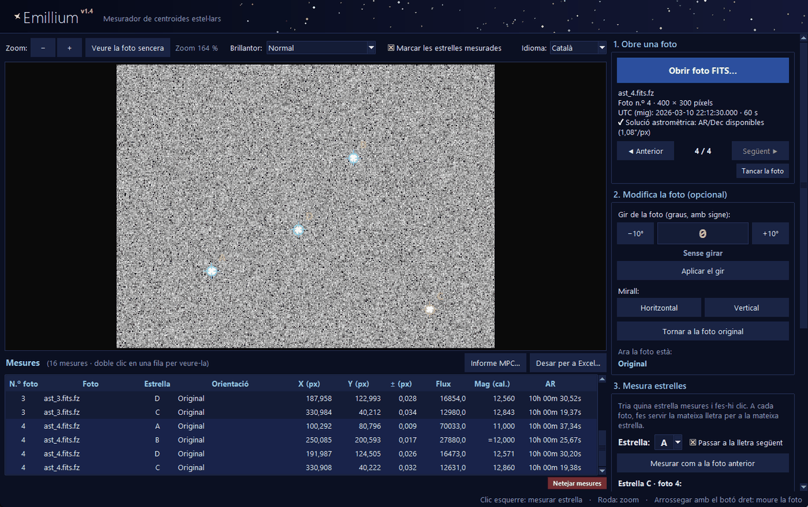
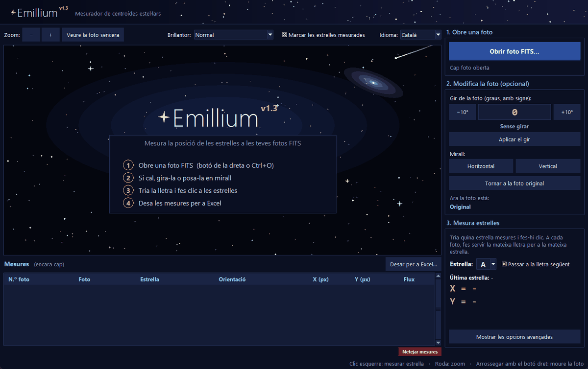
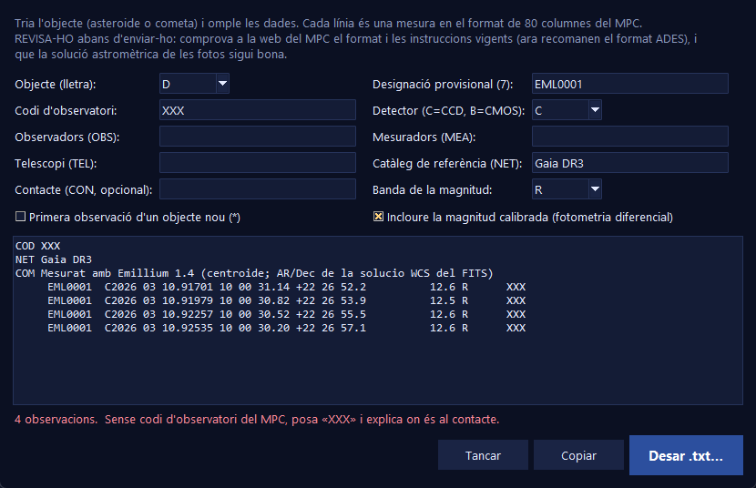

<p align="center">
  
</p>

<h1 align="center">Emillium</h1>

<p align="center">
  <b>Mesurador de centroides estel·lars per a fotos astronòmiques FITS</b><br>
  <sub>Complete Edition · v1.4</sub>
</p>

<p align="center">
  
  
  
  
  
  
  
</p>

<p align="center">
  <b>Català</b> · <a href="#resumen-en-castellano">Castellano</a>
</p>

<p align="center">
  
</p>

**Emillium** és un programa d'escriptori, lleuger i en català i castellà, per mesurar la posició de
les estrelles en fotos **FITS** amb **precisió de centèsimes de píxel**: obres una foto (o una sèrie),
fas clic a les estrelles i ho tens tot en un Excel, amb la seva incertesa, magnitud i coordenades.

Està pensat per a **astrònoms aficionats** i per a **treballs escolars** (com un *treball de recerca*):
moviments propis, estrelles dobles, satèl·lits de Júpiter, seguiment d'asteroides i cometes,
estrelles variables...

> **Lleuger** — un sol `.exe` de ~25 MB, sense instal·lar res (des del codi només cal `numpy`).<br>
> **Privat** — funciona sense internet i no envia cap dada.<br>
> **Obert i explicat** — tot (lector FITS, centroide, coordenades, Excel...) està programat a mà a
> [`codigo/Emillium.py`](codigo/Emillium.py) i comentat pas a pas.

---

## Índex

- [Dues edicions: Complete i Lite](#dues-edicions-complete-i-lite)
- [Funcions](#funcions)
- [Captures](#captures)
- [Instal·lació](#installació)
- [Guia ràpida](#guia-ràpida)
- [Precisió i validació](#precisió-i-validació)
- [Limitacions](#limitacions)
- [Com es calcula](#com-es-calcula)
- [Estructura del projecte](#estructura-del-projecte)
- [Autors i llicència](#autors-i-llicència)

---

## Dues edicions: Complete i Lite

Emillium es distribueix en dues edicions. Les dues mesuren les estrelles amb el mateix centroide
subpíxel; la diferència és tot el que hi ha al voltant.

- **Complete Edition (v1.4)** — per a astrònoms aficionats: incerteses, AR/Dec, temps, fotometria,
  sèries de fotos, fitxers `.fz` i informes per al MPC. És la que es descriu en aquest README.
- **Edició Lite (v1.3)** — la versió senzilla, pensada per a treballs escolars: obres una foto, fas clic
  a les estrelles i obtens les seves coordenades **X i Y en píxels** i el flux. Menys columnes i menys
  opcions, per no distreure.

| | Lite 1.3 | Complete 1.4 |
|---|:---:|:---:|
| Centroide subpíxel (estrella més propera al clic, veïnes brillants, avís d'estrella repetida) | ✓ | ✓ |
| Gir amb angle i signe, mirall, marques en girar | ✓ | ✓ |
| Estrelles amb lletra i Excel «estrella per estrella» (X, Y, flux) | ✓ | ✓ |
| Català i castellà, *easter eggs* | ✓ | ✓ |
| Incertesa ± de cada mesura | | ✓ |
| Magnitud instrumental i fotometria diferencial | | ✓ |
| AR/Dec (solució astromètrica TAN/SIP) | | ✓ |
| Hora UTC del mig de l'exposició i dia julià | | ✓ |
| Sèries de fotos: ◀ ▶ i «Mesurar com a la foto anterior» | | ✓ |
| FITS comprimits (`.fz`) | | ✓ |
| Informe per al Minor Planet Center | | ✓ |
| Recorda l'idioma, les opcions i l'última carpeta | | ✓ |
| Protecció contra fitxers FITS manipulats | | ✓ |

**Quina triar?** Si només necessites posicions en píxels per a un treball o una pràctica, la **Lite**.
Si fas astrometria o fotometria de debò (asteroides, estrelles variables, sèries de fotos), la **Complete**.

---

## Funcions

Funcions de la **Complete Edition**:

| | |
|---|---|
| **Centroide subpíxel** | Centre de massa iteratiu amb llindar sobre el soroll. Agafa l'estrella **més propera al clic** i, si en té una de brillant enganxada, li treu la llum. |
| **Incertesa** | ± en X, Y i en el flux de cada mesura (soroll del cel i, si el FITS porta `GAIN`, de la pròpia estrella). |
| **Coordenades celestes** | **AR i Dec** de cada estrella si la foto té solució astromètrica (per exemple d'[Astrometry.net](https://nova.astrometry.net)): projecció TAN, amb o sense distorsió **SIP**. |
| **Temps** | Hora UTC del **mig de l'exposició** i **dia julià (JD)**, a partir de `DATE-OBS` (+ `TIME-OBS`) i `EXPTIME`. |
| **Fotometria** | Flux d'obertura i **magnitud instrumental**; amb una **estrella de comparació** de magnitud coneguda, **magnitud real** de totes les altres (fotometria diferencial). |
| **Sèries de fotos** | Obre-ne moltes de cop, passa d'una a l'altra amb ◀ ▶ mantenint gir i zoom, i **mesura automàticament les mateixes estrelles que a la foto anterior**. |
| **FITS comprimits** | Obre directament fitxers **`.fz`** (RICE_1, GZIP_1, GZIP_2, també en coma flotant quantitzada), sense programes externs. |
| **Informe per al MPC** | Assistent que prepara les observacions d'un asteroide o cometa en el **format de 80 columnes del Minor Planet Center**, amb vista prèvia. |
| **Gir i mirall** | Angle amb signe, botons −10° / +10°, mirall horitzontal i vertical. Les estrelles ja mesurades segueixen marcades. |
| **Excel** | `.xlsx` real (no depèn de l'idioma d'Excel): una fila per foto i columnes per estrella, més un full amb totes les mesures. També CSV. |
| **Comoditat** | Català per defecte i castellà; recorda l'idioma, les opcions i l'última carpeta. |

## Captures

<table>
  <tr>
    <td width="58%"></td>
    <td></td>
  </tr>
  <tr>
    <td align="center"><sub>Pantalla d'inici</sub></td>
    <td align="center"><sub>Assistent de l'informe per al MPC</sub></td>
  </tr>
</table>

---

## Instal·lació

### Opció 1 · Executable per a Windows (recomanat)

1. A l'apartat [**Releases**](../../releases), descarrega l'executable de l'edició que vulguis
   (**Complete** o **Lite**).
2. Fes-hi doble clic. No cal instal·lar res. Les dues edicions es poden tenir alhora.

> [!NOTE]
> Com que el programa no està signat digitalment, la primera vegada Windows pot mostrar
> «Windows ha protegit l'equip». Prem **Més informació → Executa igualment**.

També pots arrossegar una o diverses fotos FITS sobre el `.exe` per obrir-les directament.

### Opció 2 · Des del codi

Necessita **Python 3.9 o superior** (provat amb Python 3.14), amb `tkinter` (ja ve inclòs a Windows)
i `numpy`:

```bash
pip install -r codigo/requirements.txt
python codigo/Emillium.py
```

Està provat a Windows. A Linux i macOS hauria de funcionar des del codi, però encara no s'ha provat.

---

## Guia ràpida

1. **Obrir foto FITS…** (`Ctrl+O`). Pots triar-ne diverses alhora per treballar amb una sèrie.
2. *(Opcional)* Gira-la o posa-la en mirall.
3. Tria la **lletra** de l'estrella (A, B, C...) i fes-hi **clic**. Fes servir la mateixa lletra per a la
   mateixa estrella a totes les fotos.
4. Passa a la foto següent (▶) i prem **Mesurar com a la foto anterior**.
5. *(Opcional)* A **Fotometria diferencial**, tria l'estrella de comparació i escriu la seva magnitud.
6. **Desar per a Excel…** (`Ctrl+S`) o, per a un asteroide, **Informe MPC…**

<details>
<summary><b>Ratolí i dreceres de teclat</b></summary>

| Acció | Ratolí / tecla |
|---|---|
| Mesurar una estrella | Clic esquerre |
| Zoom | Roda del ratolí (a sobre del panell dret, el desplaça) |
| Moure la foto | Arrossegar amb el botó dret |
| Foto anterior / següent | `RePàg` / `AvPàg` |
| Esborrar les mesures seleccionades | `Supr` |
| Esborrar l'última mesura | `Ctrl+Z` |
| Obrir / desar | `Ctrl+O` / `Ctrl+S` |

</details>

<details>
<summary><b>Opcions avançades</b></summary>

- **Distància màx. al clic (px)**: fins on es busca l'estrella.
- **Radi per al centre (px)**: unes 2–3 vegades la FWHM de les estrelles.
- **Llindar sobre el soroll (σ)**: quins píxels compten per al centre. **Recomanat: 3.**
  Més baix, el soroll desvia el centre de les estrelles febles; molt alt (5 o més), en estrelles
  febles gairebé només compta el píxel central.

En canviar una opció, la mesura seleccionada (o l'última) es torna a calcular sola.

</details>

**Coordenades en píxels:** X cap a la dreta i Y cap amunt; el centre del píxel de baix a l'esquerra és
(0, 0). Es donen sobre la foto **tal com es veu** (després del gir i el mirall). Les AR/Dec sempre es
calculen sobre la foto original, així que no depenen del gir.

---

## Precisió i validació

Tot s'ha comprovat amb estrelles simulades en posicions conegudes i comparant amb
[astropy](https://www.astropy.org), la biblioteca de referència en astronomia:

| Què | Resultat |
|---|---|
| Centre d'estrelles brillants / febles | error de ~0,003–0,01 px / ~0,05 px |
| Incertesa ± predita | coincideix amb la dispersió real (simulació de Monte Carlo) amb un ~10–15 % |
| AR/Dec (TAN, CDELT+CROTA i SIP) | diferència màxima de **0,004″** amb astropy en 3.000 punts |
| Dia julià | diferència màxima de **0,5 ms** amb astropy en 500 dates |
| Fitxers `.fz` | resultat **idèntic** a astropy en 20 combinacions de compressió, tipus de dades i quantització |
| Fotometria diferencial | magnitud real d'una estrella simulada recuperada amb un error de 0,02 mag |
| Informe MPC | línies de 80 columnes; posicions a 0,02–0,11″ de les reals |

Per repetir les proves bàsiques (només necessita `numpy`):

```bash
python proves/prova_precisio.py
```

---

## Limitacions

**Fotos i coordenades**

- **No resol l'astrometria**: per tenir AR/Dec, la foto ha de venir ja resolta (Astrometry.net, ASTAP, Siril...).
- Les AR/Dec només surten amb solucions de projecció **TAN** (amb o sense SIP). Amb altres projeccions
  (TPV, ZPN...) la foto s'obre i es mesura en píxels, però sense coordenades celestes.
- Considera que `DATE-OBS` és l'**inici** de l'exposició (i hi suma `EXPTIME`/2). Si la teva càmera hi
  desa el mig de l'exposició, l'hora quedarà desplaçada mitja exposició.
- Llegeix només la **primera imatge** del fitxer FITS; si és una imatge en color (diversos plans), els
  fa la mitjana.
- No llegeix els formats comprimits poc habituals **HCOMPRESS_1** i **PLIO_1** (avisa; cal fer servir `funpack`).
- No calibra (biaix, foscos, flats) ni apila fotos.

**Mesures i resultats**

- Les incerteses ± són **estadístiques** (soroll): no inclouen errors sistemàtics ni l'error de la
  solució astromètrica de la foto.
- La fotometria diferencial fa servir **una** estrella de comparació, sense correcció de color ni d'extinció.
- L'informe del MPC és en el format clàssic de 80 columnes, que el MPC encara accepta, però des de 2018
  el format recomanat és **ADES**, i Emillium no el genera.

**Sistema**

- Només s'ha provat a **Windows**.

> [!IMPORTANT]
> Abans d'enviar cap informe al Minor Planet Center, revisa'l i consulta les instruccions vigents
> a la [web del MPC](https://minorplanetcenter.net). Comprova també que la solució astromètrica de
> les fotos sigui bona.

---

## Com es calcula

<details>
<summary><b>Resum del mètode</b> (tot està explicat també al codi)</summary>

1. **Pic més proper al clic** entre els que destaquen sobre el soroll.
2. **Fons del cel** en un anell al voltant de l'estrella (mediana amb retall a 3σ).
3. Si hi ha una **veïna brillant**, se li treu la llum aprofitant que és simètrica.
4. **Centre de massa** dels píxels que superen el fons + llindar·σ, recentrant fins que es mou menys
   de 0,0001 px.
5. **Incerteses**: σ<sub>X</sub>² = Σ (x<sub>i</sub> − X)² · σ<sub>i</sub>² / (Σ w<sub>i</sub>)², amb
   σ<sub>i</sub>² = σ<sub>cel</sub>² (+ senyal / guany).
6. **AR/Dec**: píxel → correcció SIP → matriu CD → projecció gnomònica inversa.
7. **Dia julià**: algorisme de Meeus (*Astronomical Algorithms*).
8. **Fotometria diferencial**: m = m<sub>inst</sub> − m<sub>inst, comp</sub> + m<sub>catàleg, comp</sub>,
   amb error √(σ² + σ<sub>comp</sub>²).
9. **`.fz`**: lectura de la taula binària de «teseles» i descompressió RICE (decodificada en paral·lel
   per a totes les files amb numpy) o gzip; a les imatges en coma flotant es desfà la quantització amb
   la taula de nombres aleatoris estàndard del FITS.
10. **MPC**: data UTC del mig de l'exposició amb 5 decimals de dia (~0,9 s), AR a 0,01 s i Dec a 0,1″.

</details>

<details>
<summary><b>Seguretat i privacitat</b></summary>

- No fa servir internet ni executa programes externs.
- Només llegeix les fotos que obres i escriu on tu dius (Excel, CSV, informe), més els ajustos a
  `%APPDATA%\Emillium\ajustes.json` i dos sons a la carpeta temporal.
- Els FITS manipulats (mides negatives o enormes) es rebutgen, i els textos que van al CSV es
  protegeixen contra la «injecció de fórmules».

</details>

<details>
<summary><b>Combinacions secretes</b></summary>

Hi ha uns quants *easter eggs* astronòmics. Prova d'escriure a la pantalla d'inici `M42`, `618`, `M1`,
`M16`, `1977`, `2001`, `ISS`, `EARTH`, `WOW`, `SPOCK`, `GARGANTUA` o `42`...

</details>

---

## Estructura del projecte

```
Emillium/
├── codigo/
│   ├── Emillium.py          # tot el programa, comentat
│   ├── Emillium.spec        # configuració per crear el .exe
│   ├── requirements.txt     # numpy
│   └── icono.ico
├── proves/
│   └── prova_precisio.py    # prova de precisió amb estrelles simulades
├── docs/                    # imatges d'aquest README
├── LICENSE
└── README.md
```

### Crear l'executable

```bash
pip install pyinstaller
cd codigo
pyinstaller Emillium.spec
```

L'`Emillium.exe` apareix a `codigo/dist/`.

---

## Autors i llicència

Fet per **Plutarco Martínez** i **Emilio Ruiz**, amb l'assistència de **Claude Code**.

Distribuït sota la [llicència MIT](LICENSE): el pots fer servir, modificar i compartir lliurement,
mantenint l'avís de llicència.

---

## Resumen en castellano

Hay **dos ediciones**:

- **Complete Edition (v1.4)**, para astrónomos aficionados, con todo lo que se describe abajo.
- **Edición Lite (v1.3)**, la versión sencilla para trabajos escolares: mide las estrellas y da sus
  coordenadas X e Y en píxeles y el flujo, con menos columnas y opciones.

**Emillium Complete** mide la posición de las estrellas en fotos FITS con **precisión subpíxel**, con su
incertidumbre, magnitud instrumental y calibrada (fotometría diferencial con una estrella de
comparación), **AR/Dec** si la foto tiene solución astrométrica (TAN/SIP), y hora UTC y día juliano del
centro de la exposición.

Trabaja con **series de fotos** (incluso mide automáticamente las mismas estrellas que en la foto
anterior), abre **FITS comprimidos (`.fz`)**, prepara **informes en el formato de 80 columnas del Minor
Planet Center** y exporta a **Excel**. Funciona sin internet, está en catalán y castellano (desplegable
«Idioma») y el código está comentado en castellano paso a paso.

Para usarlo, descarga el ejecutable de la edición que quieras (Complete o Lite) de
[Releases](../../releases), o ejecuta la Complete desde el código con
`pip install -r codigo/requirements.txt` y `python codigo/Emillium.py`.
